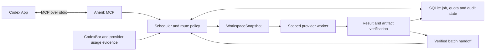

# Ahenk MCP

Ahenk MCP is a local Go server for delegating bounded tasks to multiple AI providers from Codex App. Codex remains the controller. Ahenk schedules jobs, chooses eligible models based on quota and policy, and returns results with enough evidence for the controller to review them.

## Architecture



## Providers and execution modes

| Provider | Implemented scope |
| --- | --- |
| Local fixtures | Offline, explicitly enabled `read_only` and `patch` tasks, including verified batch handoffs. |
| Antigravity (AGY Headless) | Restricted synthetic pilot through an audited and signed CLI, using the existing authorized local session. Live M1 verified a narrowly scoped synthetic patch. The `analysis` and `review` profiles receive scoped snapshot context and keep provider filesystem tools disabled. |
| OpenCode Free | Anonymous, tool-free, synthetic `read_only` tasks using an audited OpenCode App binary and exact zero-price models. The default transport is `stateless_text`. The explicit `native_read_ask` transport has a narrower allowlist and is experimental. |
| CodexBar | Optional quota observation for Codex and Antigravity. It does not execute delegated tasks. |
| GitHub Copilot CLI | Disabled pending verification of access and cost policies. |

Provider CLI availability, model access, and subscription quotas depend on your own authorized accounts. Sign in to AGY through its supported client before using subscription routes. The verified OpenCode Free route uses an anonymous worker. The offline fixture workflow requires no provider account.

## Requirements and installation

The current source version is `0.3.0-beta.1`. Use `make dist` to build the local Intel macOS archive with the Apache license and dependency notices.

The tested target is Intel macOS (`darwin/amd64`). Install Go 1.27 or newer and Git. The core build uses pure-Go SQLite and runs with CGO disabled. The live adapters also depend on audited provider binaries and macOS tools such as `codesign`. Other platforms have no release qualification.

```sh
git clone https://github.com/faoztas/ahenk-mcp.git
cd ahenk-mcp
mkdir -p bin
CGO_ENABLED=0 GOOS=darwin GOARCH=amd64 go build -trimpath -o bin/ahenk ./cmd/ahenk
bin/ahenk version
```

To try the offline fixture, create a disposable repository with one committed file. Copy [the fixture configuration](examples/ahenk.fixture.json) into the private directory created below. Replace its two placeholder paths with the paths printed by the script.

```sh
demo_dir="$(mktemp -d)"
demo_dir="$(cd "$demo_dir" && pwd -P)"
mkdir -m 700 "$demo_dir/state"
git init "$demo_dir/repo"
printf 'before\n' > "$demo_dir/repo/fixture.txt"
git -C "$demo_dir/repo" add fixture.txt
git -C "$demo_dir/repo" -c user.name=Fixture -c user.email=fixture@example.test \
  -c commit.gpgsign=false -c core.hooksPath=/dev/null commit -m "Initialize fixture"
cp examples/ahenk.fixture.json "$demo_dir/ahenk.json"
printf 'Repository: %s\nState: %s\nConfiguration: %s\n' "$demo_dir/repo" "$demo_dir/state" "$demo_dir/ahenk.json"
```

## Connect Codex App

Add the following to `~/.codex/config.toml` or a trusted project's `.codex/config.toml`. Use absolute paths to the binary and edited configuration, then reconnect the MCP server. Call `list_capabilities` for `repo_id: "demo"` to confirm that the scheduler and fixture routes are available. [Codex MCP configuration](https://learn.chatgpt.com/docs/extend/mcp?surface=app#configure-with-configtoml)

```toml
[mcp_servers.ahenk]
command = "/absolute/path/to/ahenk-mcp/bin/ahenk"
args = ["serve", "--stdio", "--config", "/absolute/path/to/ahenk.json"]
```

Submit this example with `delegate_task`.

```json
{
  "request_id": "demo-1",
  "repo_id": "demo",
  "objective": "Verify the synthetic patch workflow",
  "acceptance": [{"id": "patch", "description": "Return an applicable patch for fixture.txt"}],
  "allowed_paths": ["fixture.txt"],
  "mode": "patch",
  "data_class": "synthetic",
  "deadline_seconds": 120
}
```

Poll `get_job_status` with the returned job ID. Use `get_job_result` to read the summary and artifact ID. Request `view: "diff"` with that artifact ID to see the verified change from `before` to `after`. The eight MCP tools are `delegate_task`, `delegate_batch`, `get_job_status`, `get_job_result`, `list_jobs`, `list_capabilities`, `cancel_job`, and `resume_job`.

## Configuration and security

Register each repository by ID, absolute Git root, path allowlist, and provider allowlist. The repository needs a `HEAD` commit. Keep the state directory outside all registered repositories and restricted to its owner (`0700`). Keep local configuration, account bindings, databases, diffs, and logs out of version control. Ahenk reads JSON via `--config`; the offline setup needs no environment variables.

Each repository may set `limits` to tighten the scheduler policy. Supported keys are `max_batch_tasks`, `max_active`, `max_deadline_seconds`, `minimum_quality_tier`, and `require_independent_review`. A repository’s `AGENTS.md` can enter the snapshot only through the registered and requested path scope. Its contents cannot grant permissions. Session continuations remain inside the provider attempt that created them.

Provider opt-in is separate from repository permission. The live pilots require synthetic data and verified provider identities. `repository_internal` requests are blocked until a certified data policy exists. A path allowlist and temporary workspace restrict the context Ahenk prepares, while the operating system and provider still determine subprocess access. See the [security policy](SECURITY.md).

- **AGY.** `ahenk probe-agy --config FILE` checks the audited binary, signature, and official `/usage` output. The synthetic pilot uses signed AGY 1.5.3 or 1.5.4 and `gemini-3.8-flash-medium`. Version-specific evidence determines the allowed profile. It requires fresh Gemini subscription windows and checks model, workspace, agent, and permission mode before sending the prompt. Ahenk disables automatic updates and requests `useG1Credits:false`. The CLI does not attest the effective runtime credit setting.
- **OpenCode.** Use `ahenk probe-opencode-catalog` to inspect the pinned OpenCode 2.2.6 binary's isolated catalog. Use `--public` for the public catalog. Configure an exact supported `opencode/<model>` ID, the audited App binary path and SHA-256, and `enable_synthetic: true`. Each attempt starts a fresh worker on loopback. The read-only native route rejects permission requests and results containing tool calls. A zero-price catalog entry alone does not establish supported execution or live capacity.
- **CodexBar.** `ahenk decode-quota --provider codex` (also `antigravity` or `copilot`) normalizes a usage export from stdin without emitting account identifiers. `enable_codexbar` enables live polling of the pinned local binary. For account binding, set `codexbar_account_sha256` keys `codex` and `agy` to the SHA-256 of the independently verified, trimmed, lowercase account email. Leave a binding unset if the working session cannot be independently identified. `ahenk probe-codexbar --config FILE --provider codex` (or `agy`) checks the effective source and match without starting the scheduler.
- **Capacity policy.** The optional `capacity_policy` object defaults to `{"mode":"quality_first","agy_weekly_min_remaining_pct_while_codex_available":15,"codex_low_pct":20,"codex_critical_pct":10}`. `balanced` gives latency more weight. `conserve` favors lower usage within the same verified quality tier. Tasks can select a mode through `strategy`. CodexBar polls every five minutes and Codex is a controller signal only. Each AGY family has a separate reserve, a bounded dispatch buffer, and a native subscription quota check before a prompt. Unknown Codex capacity keeps the reserve in place.
- **Capacity warnings.** `list_capabilities` with `include_quota:true` returns the normalized controller, AGY, and OpenCode Free capacity alongside the existing quota fields. Supply `repo_id` for a scoped utility routing preview. Job responses include stable warning IDs and route evidence when relevant. Use `model_audit_file` for the discovered model inventory. Inference evidence admits scoped read-only work. Explicit architecture, planning, reasoning, and research requests require evidence for the requested role. A repository can allow a task-scoped reserve exception with `allow_agy_weekly_reserve_override:true` and a short `agy_weekly_reserve_override` justification on that task. The exception preserves cost, account, exhaustion, and review checks.

## Quota-aware routing

Use `list_capabilities` with `include_quota: true` to see known, stale, and unknown windows. Routing uses fresh, matched measurements, keeps Antigravity model families separate, and uses the weekly window for Codex controller capacity. OpenCode numeric capacity remains `UNKNOWN` without measurement. Rate limits, access failures, and transient errors are scoped to the exact account, model, and transport unless the provider explicitly asserts a shared scope. Persisted cooldowns honor valid provider retry hints. Newer verified success on the same route supersedes an older gate across restarts. An eligible alternate route can run independently. M1 receivers are limited to exact OpenCode routes with local smoke and recovery evidence.

A standalone synthetic read-only `delegate_task` can set `opencode_recheck:true` with `preferred_provider:"opencode"` and an exact native Free `preferred_model`. It runs a fixed marker prompt at most once for a suspicious unscoped native 429. Active explicit scopes remain gated. `list_capabilities` reports effective `retry_at` separately from any provider-reported absolute `reset_at` and never initiates a probe.

For a qualified synthetic role, set `task_class` to `architecture`, `planning`, `reasoning`, or `research`. A standalone synthetic read-only task with `role_calibration:true` and an exact preferred route can run the built-in four-role fixture under ordinary quota and cost policy. Durable passing evidence remains bound to that route.

`ahenk import-opencode-cooldown --config FILE --from-state DIR` reads prior cooldown evidence from an idle state directory without modifying its database or WAL. SQLite may use its shared-memory sidecar. Repeat `--from-state` to inspect multiple sources.

### Model audits and continuation

Use `ahenk audit-models --config FILE` to discover installed and published candidates. Add `--live` to run bounded synthetic checks. AGY protects a 15% reserve in each shared quota window. OpenCode requires a verified anonymous free route. Set `model_audit_file` to the absolute path of a private, user-owned audit file to load recent passing evidence for synthetic read-only routing. Use a regular file with mode `0600` or `0400` and a single link. To write a new inventory, redirect the audit output under `umask 077`. The same file rules apply to `audit-models --previous`. See the [dated model matrix](docs/evidence/model-compatibility-2026-11-10.md).

A synthetic read-only task can include one `follow_up` prompt to reuse its own native AGY or OpenCode session. Ahenk keeps the original snapshot and deadline and records both terminal turns. A synthetic `trusted-local` task can include a `checkpoint_objective` when the repository explicitly allows both coding providers. Ahenk persists the scoped partial diff, pauses the job, and uses a different provider family on `resume_job`. It verifies the source, artifact hash, and preimages before the second provider starts. The optional `native_child` profiles remain experimental. See the [M2B milestone](docs/milestones/m2b-agent-orchestration.md).

## Workspace snapshots, artifacts, and handoffs

Ahenk defaults to a `head_only` snapshot. `include_working_changes` captures scoped staged and unstaged content. Select untracked files explicitly via `untracked_paths`. Ahenk verifies patches in a separate temporary tree and returns a diff for review, leaving the source worktree and Git index intact. The verification tree provides file separation and is not an operating-system sandbox.

A batch can order jobs with `depends_on` and pass a verified predecessor's `diff` or `summary` via `handoff_from`. Transfers are limited to direct dependencies in the same synthetic batch and snapshot, with a combined 64 KiB budget. The scheduler checks the receiver's scope and the content hash before dispatch. The route view exposes the handoff manifest. The `review` profile requires one verified `diff` handoff in a `distinct_provider` batch and binds its structured verdict to the artifact hash. Use `analysis` for standalone reading without a diff. Tasks requiring deterministic checks that Ahenk cannot run remain blocked.

For a high-level synthetic objective, add `"decompose": true` to `delegate_task`. Ahenk selects a planning-qualified model, validates a graph of one to eight steps, and routes the steps through the same scheduler. The planner cannot change approved paths, provider eligibility, checks, or execution permissions. For patch jobs, a single implementation step keeps the original acceptance criteria. Critical changes and repositories that require review must include a separate reviewer that receives the verified diff. Inspect the parent’s route for the plan hash and retrieve diffs, checks and verdicts from its child jobs.

One stdio process owns a state directory. A second connection reports `state_busy`. On shutdown, Ahenk stops workers. A later connection can resume an eligible job against its original snapshot and deadline. A missing worker lease or cleanup marker quarantines the attempt and can block dispatch.

### Trusted-local synthetic Go tasks

A repository can explicitly opt in to native editing with a `trusted_local` policy. Set the task's `execution_profile` to `trusted-local`, `mode` to `patch`, and `data_class` to `synthetic`. Select the approved source, root module and test files in `allowed_paths`. Include an acceptance criterion with a registered `check_id`. For example, add this policy to a disposable repository's configuration.

```json
"trusted_local": {
  "provider": "agy",
  "write_paths": ["calc.go"],
  "go_checks": {"target": "TestCalculation"}
}
```

Use `opencode` with its audited native GLM route to select an OpenCode Free writer. The writer performs native file operations in a private detached worktree. Ahenk executes the named root-package Go test, records its exit status, and checks that the test run left the diff and source unchanged. The provider command tools stay disabled. Go must be available on the server's path. Dependency downloads are disabled for these checks.

Trusted-local execution has the host authority of the local user and provides no OS-level containment. Limit it to disposable synthetic data and trusted test code. The restricted, analysis, review and patch-only routes keep their existing defaults. See the [security policy](SECURITY.md) for the execution boundary.

## Status and limitations

The offline core, a synthetic AGY-to-OpenCode M1 batch, and automatic AGY decomposition and coding have acceptance evidence. Provider-native subagents remain experimental. Signed AGY 1.5.4 did not return a verifiable child identity, and the OpenCode Free child attempt hit an upstream rate limit. The live adapters are opt-in pilots with version, permission, and data restrictions. Direct `implementation` worktree execution is available only for an explicitly preferred offline fixture provider. Native synthetic writers require the separate trusted-local opt-in and registered check evidence. See the [M2A milestone](docs/milestones/m2a-real-coding-agents.md), [goal status](docs/goal-status.md), and [M1 evidence](docs/evidence/m1-build.md). See the [public beta acceptance record](docs/evidence/public-beta-acceptance.md) for the current release gate.

`ahenk readiness --config FILE` reads local state without initiating provider calls. It reports `OFFLINE_CORE_READY`, `AGY_LIVE_READY`, `OPENCODE_LIVE_READY`, and `MULTI_PROVIDER_LIVE_READY` separately. Individual live readiness uses a controlled synthetic `read_only` task with a `readiness` acceptance item of the form `Return exactly ahenk-ready-<unique-marker>`. The marker suffix must be 8–64 ASCII letters, digits, underscores, or hyphens. Multi-provider readiness additionally requires a verified diff handoff in a `distinct_provider` batch.

## Development and testing

```sh
CGO_ENABLED=0 go test -mod=readonly -count=1 ./...
CGO_ENABLED=1 go test -mod=readonly -race -count=1 ./...
CGO_ENABLED=0 go vet -mod=readonly ./...
go mod verify
```

The race detector requires a working C toolchain, such as Xcode Command Line Tools on macOS. For a local Intel macOS archive with license and attribution files, run `make dist`. See [contribution guidance](CONTRIBUTING.md) for regression and release checks.

## License and attribution

Copyright 2026 Furkan Anıl Öztaş.

Ahenk MCP is distributed under the [Apache License, Version 2.0](LICENSE) (`Apache-2.0`). Dependencies retain their upstream terms. See [third-party licensing](docs/third-party-licenses.md) for the inventory and binary redistribution requirements. Ahenk MCP is an independent project.
