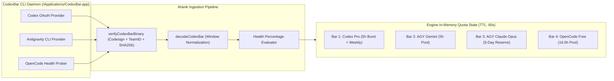

# Epic 1: CodexBar Real-Time Quota Telemetry & Observer

**Epic Identifier:** `EPIC-ROUTING-01`  
**Parent Initiative:** Multi-Provider Dynamic Routing Architecture  
**Status:** In Progress / Ready for Development  
**Lead Architect:** Winston (System Architect) & John (Product Manager)  

---

## 1. Epic Goal & Value Proposition

Transform Ahenk MCP from a blind task dispatcher into an intelligent, quota-aware orchestrator by establishing real-time telemetry integration with the native `CodexBar CLI` helper. By continuously reading and normalizing four distinct quota windows—without exposing user credentials or requiring third-party API keys—Ahenk gains instantaneous visibility into provider capacity, enabling proactive throttling and zero-downtime failover before rate limits are hit.



---

## 2. Stories Breakdown

### Story 1.1: Multi-Provider Quota Window Parsing & Normalization

**User Story:**
> **As an** Ahenk MCP Scheduler,  
> **I want to** ingest and parse quota records from CodexBar across 4 distinct provider windows (Codex 5h/weekly, Antigravity Gemini 5h, Antigravity Claude Opus 5-day, and OpenCode Free 16.6h),  
> **So that** the router can accurately distinguish between independent provider pools and avoid assuming uniform quota depletion.

**Acceptance Criteria (Gherkin):**

```gherkin
Feature: Multi-Provider Quota Parsing

  Scenario: Parse Codex Pro 5-hour and weekly windows
    Given a valid CodexBar JSON export for provider "codex" with a primary 300-minute window and weekly window
    When decodeCodexBar is invoked with the JSON reader
    Then two Quota objects are returned: "primary" (windowMinutes=300) and "secondary" (windowMinutes=10080)
    And each Quota object contains state "KNOWN", unit "percent", and calculated Remaining percentage.

  Scenario: Parse Antigravity split Gemini and Claude Opus buckets
    Given a valid CodexBar JSON export for provider "antigravity"
    And the extra rate windows contain "antigravity-quota-summary-gemini-5h" and "antigravity-quota-summary-3p-weekly"
    When decodeCodexBar is invoked for provider "antigravity"
    Then the returned quotas contain distinct buckets:
      | Bucket | Family | WindowMinutes |
      | gemini-5h | gemini | 300 |
      | 3p-weekly | claude_gpt | 10080 |
    And the Claude Opus 5-day reserve is tracked separately from the Gemini pool.

  Scenario: Parse OpenCode Free 16.6-hour shared pool window
    Given an OpenCode rate limit event with 16.6-hour reset window
    When openCodeQuota evaluates the active gate
    Then a Quota record for provider "opencode" is emitted with WindowMinutes=996 (16.6h)
    And State is set to "EXHAUSTED" when a 429 gate is active.
```

**Technical Specifications:**
- **Files Modified:**
  - `internal/providers/codexbar.go`
  - `internal/providers/quota.go`
  - `internal/providers/codexbar_084_test.go`
- **Data Models:**
  ```go
  type QuotaBarID string
  const (
      BarCodexBurst   QuotaBarID = "codex_5h_burst"
      BarCodexWeekly  QuotaBarID = "codex_weekly"
      BarAgyGemini    QuotaBarID = "agy_gemini_5h"
      BarAgyOpus      QuotaBarID = "agy_opus_5d"
      BarOpenCodeFree QuotaBarID = "opencode_free_16h"
  )
  ```
- **Error Handling:** If CodexBar JSON contains syntax errors, unexpected schema deviations, or missing timestamp values, return `UnknownQuota(provider)` with `Reason="USAGE_UNAVAILABLE"` without panicking.

**Testing Scenarios:**
- Unit test using recorded testdata fixtures: `internal/providers/testdata/codexbar_084_codex.json`, `codexbar_084_antigravity.json`.
- Benchmark test: JSON parsing throughput must exceed $10,000\text{ ops/sec}$ with zero heap escapes on hot path.

---

### Story 1.2: Normalized Four-Bar Health Metric & Periodic Observer Worker

**User Story:**
> **As an** Ahenk Orchestration Engine,  
> **I want to** run a background observer worker that polls CodexBar every 60 seconds and computes a normalized 0.0 to 1.0 health metric for each of the four bars,  
> **So that** routing decisions use warm, non-blocking in-memory telemetry without delaying task dispatching.

**Acceptance Criteria (Gherkin):**

```gherkin
Feature: Quota Observer Health Calculation

  Scenario: Normalizing remaining quota to health percentage
    Given a quota record with Remaining = 72.5%
    When the health percentage is computed
    Then health_pct is evaluated to 0.725
    And the bar state is flagged as HEALTHY.

  Scenario: Low quota triggers pressure threshold
    Given a quota record with Remaining = 18.0%
    When the health percentage is computed
    Then health_pct is evaluated to 0.18
    And the bar state is flagged as PRESSURE_HIGH.

  Scenario: Asynchronous cache refresh does not block scheduler
    Given the cached quota snapshot is 65 seconds old (exceeds TTL of 60s)
    When a new task is submitted via Submit()
    Then the task route is resolved instantly using the existing snapshot (< 5ms)
    And an asynchronous goroutine is spawned to refresh CodexBar telemetry in the background.
```

**Technical Specifications:**
- **Files Modified:**
  - `internal/orchestration/quota.go`
  - `internal/orchestration/capacity_policy.go`
  - `internal/orchestration/engine.go`
- **Health Normalization Formula:**
  $$\text{health\_pct} = \max\left(0.0, \min\left(1.0, \frac{\text{Remaining}}{100.0}\right)\right)$$
- **Concurrency Control:** Maintain atomic boolean flag `quotaRefreshing` in `Engine` struct to ensure at most one background refresh process executes concurrently (`CompareAndSwap(false, true)`).

**Testing Scenarios:**
- Race condition test: Execute 50 concurrent `Engine.Quota()` calls while a background refresh is actively parsing mock JSON. Run with `go test -race`.
- Verification of snapshot timestamp updating and stale state flagging after 15 minutes without refresh.

---

### Story 1.3: Tamper-Resistant Binary Verification & Security Invariants

**User Story:**
> **As a** Security Engineer,  
> **I want** Ahenk to verify the macOS code signature, Developer Team ID, and SHA-256 hash of the CodexBar helper binary before execution,  
> **So that** malicious binaries, PATH spoofing, or environment-injected API keys cannot compromise the scheduler or leak private source code.

**Acceptance Criteria (Gherkin):**

```gherkin
Feature: CodexBar Binary Security Verification

  Scenario: Valid signed binary passes verification
    Given the CodexBar binary at "/Applications/CodexBar.app/Contents/Helpers/CodexBarCLI"
    And codesign verifies strictly with TeamIdentifier "Y5PE65HELJ"
    And SHA-256 matches a known release ("0.83.0" or "0.84.0")
    When verifyCodexBarBinary is invoked
    Then verification succeeds and the binary fingerprint is returned.

  Scenario: Tampered or unsigned binary is rejected immediately
    Given a fake binary injected into PATH with invalid signature
    When verifyCodexBarBinary is invoked
    Then verification fails with error "CODEXBAR_BINARY_UNVERIFIED"
    And ReadCodexBar returns UnknownQuota without executing the binary.

  Scenario: Zero environment variable leakage
    When runUsage prepares the execution command for CodexBar CLI
    Then the command environment is stripped of all OpenAI, Anthropic, or Gemini API keys
    And PATH is restricted to the isolated temporary directory and system standard paths.
```

**Technical Specifications:**
- **Files Modified:**
  - `internal/providers/codexbar.go`
  - `internal/providers/codexbar_test.go`
- **Security Invariants:**
  - Expected Team Identifier: `Y5PE65HELJ`
  - Browser suppression: Link `open` to `/usr/bin/false` in the execution temporary directory to prevent interactive browser window popups.
  - Subprocess timeouts bounded strictly to $4\text{ seconds}$ per probe.

**Testing Scenarios:**
- Mock non-codesigned binary test asserting `CODEXBAR_BINARY_UNVERIFIED`.
- Inspection of `exec.Cmd.Env` array to ensure no `OPENAI_API_KEY`, `ANTHROPIC_API_KEY`, or `GOOGLE_API_KEY` are present.
