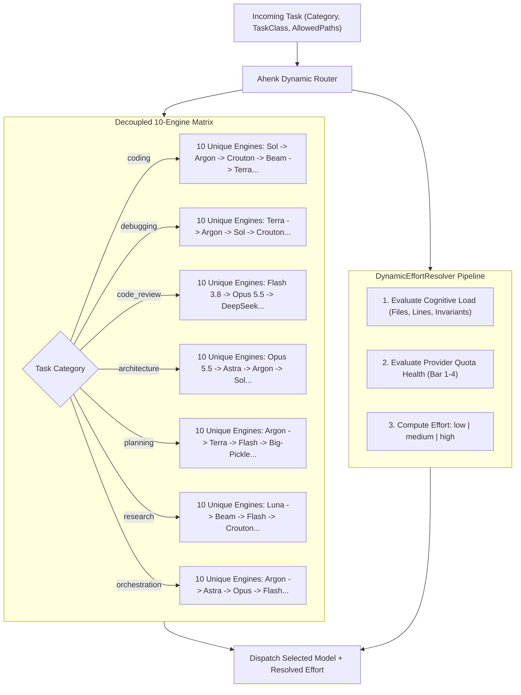

# Epic 2: Model De-coupling & Dynamic Effort Resolver

**Epic Identifier:** `EPIC-ROUTING-02`  
**Parent Initiative:** Multi-Provider Dynamic Routing Architecture  
**Status:** In Progress / Ready for Development  
**Lead Architect:** Amelia (Senior Software Engineer) & Winston (System Architect)  

---

## 1. Epic Goal & Value Proposition

Eliminate the dangerous anti-pattern of treating multiple effort levels of the same model (e.g. `argon#high`, `argon#med`, `argon#low`) as sequential fallback tiers, which creates false redundancy and leads to cascading failure during provider outages. This epic decouples model identity from reasoning effort level by establishing a **10-unique model engine matrix (1 Primary + 9 Fallbacks)** for each task category, and introduces a runtime `DynamicEffortResolver` that computes optimal reasoning effort on the fly based on cognitive load, model capability, and real-time quota headroom.



---

## 2. Stories Breakdown

### Story 2.1: Model Decoupling & 10-Unique Engine Priority Matrix Implementation

**User Story:**
> **As an** Orchestration Engine,  
> **I want to** evaluate a strictly distinct 10-engine fallback chain for each task category where no model engine appears more than once,  
> **So that** when a primary provider encounters a rate limit or service outage, the fallback instantly transitions to a genuinely independent model without wasting attempts on the dead provider.

**Acceptance Criteria (Gherkin):**

```gherkin
Feature: 10-Unique Engine Priority Matrix

  Scenario Outline: Validating uniqueness of 10 fallback engines per category
    Given the routing priority table for task category "<category>"
    When the candidate fallback stack is inspected
    Then exactly 10 distinct model engines are present (1 Primary + 9 Fallbacks)
    And no two entries in the fallback stack share the same underlying model ID
    And the first fallback engine belongs to a different provider package than the primary.

    Examples:
      | category             | primary                      | fallback_1                     |
      | coding               | codex/gpt-6.1-sol           | antigravity/gemini-4-argon     |
      | debugging            | codex/gpt-6.1-terra         | antigravity/gemini-4-argon     |
      | code_review          | antigravity/gemini-3.8-flash| antigravity/claude-opus-5-5    |
      | architecture         | antigravity/claude-opus-5-5 | codex/gpt-6-astra              |
      | planning             | antigravity/gemini-4-argon  | codex/gpt-6.1-terra            |
      | research             | codex/gpt-6-luna            | opencode/beam-free             |
      | agent_orchestration  | antigravity/gemini-4-argon  | codex/gpt-6-astra              |

  Scenario: Discarding duplicate variants
    Given a configuration attempting to register "gemini-4-argon" as both Primary and Fallback #1 with different effort tags
    When the candidate stack is validated by Ahenk Router
    Then the configuration is rejected with error "DUPLICATE_FALLBACK_ENGINE".
```

**Technical Specifications:**
- **Files Modified:**
  - `internal/orchestration/engine.go`
  - `internal/orchestration/role_calibration.go`
  - `internal/model/model.go`
- **10-Engine Matrices Data Table:**
  ```go
  var PriorityMatrix = map[string][]string{
      "coding": {
          "codex/gpt-6.1-sol", "antigravity/gemini-4-argon", "opencode/crouton-alpha-free",
          "opencode/beam-free", "codex/gpt-6.1-terra", "antigravity/gemini-3.8-flash",
          "opencode/deepseek-v4.1-flash-free", "codex/gpt-6-astra", "opencode/iceman-free",
          "opencode/minimax-m3.1-flash-free",
      },
      "debugging": {
          "codex/gpt-6.1-terra", "antigravity/gemini-4-argon", "codex/gpt-6.1-sol",
          "opencode/crouton-alpha-free", "opencode/beam-free", "opencode/deepseek-v4.1-flash-free",
          "opencode/big-pickle", "antigravity/gemini-3.8-flash", "codex/gpt-6-astra",
          "opencode/iceman-free",
      },
      "code_review": {
          "antigravity/gemini-3.8-flash", "antigravity/claude-opus-5-5", "opencode/deepseek-v4.1-flash-free",
          "codex/gpt-6.1-terra", "antigravity/gemini-4-argon", "opencode/crouton-alpha-free",
          "codex/gpt-6.1-sol", "codex/gpt-6-astra", "opencode/beam-free", "opencode/big-pickle",
      },
      "architecture": {
          "antigravity/claude-opus-5-5", "codex/gpt-6-astra", "antigravity/gemini-4-argon",
          "codex/gpt-6.1-sol", "antigravity/gemini-3.8-flash", "opencode/crouton-alpha-free",
          "opencode/beam-free", "codex/gpt-6.1-terra", "opencode/deepseek-v4.1-flash-free",
          "opencode/big-pickle",
      },
      "planning": {
          "antigravity/gemini-4-argon", "codex/gpt-6.1-terra", "antigravity/gemini-3.8-flash",
          "opencode/big-pickle", "opencode/crouton-alpha-free", "opencode/beam-free",
          "opencode/deepseek-v4.1-flash-free", "codex/gpt-6.1-sol", "codex/gpt-6-astra",
          "opencode/iceman-free",
      },
      "research": {
          "codex/gpt-6-luna", "opencode/beam-free", "antigravity/gemini-3.8-flash",
          "opencode/crouton-alpha-free", "codex/gpt-6.1-terra", "opencode/deepseek-v4.1-flash-free",
          "antigravity/gemini-4-argon", "opencode/iceman-free", "opencode/minimax-m3.1-flash-free",
          "opencode/longcat-2.5-free",
      },
      "agent_orchestration": {
          "antigravity/gemini-4-argon", "codex/gpt-6-astra", "antigravity/claude-opus-5-5",
          "antigravity/gemini-3.8-flash", "opencode/crouton-alpha-free", "opencode/beam-free",
          "codex/gpt-6.1-terra", "opencode/deepseek-v4.1-flash-free", "codex/gpt-6.1-sol",
          "opencode/iceman-free",
      },
  }
  ```

**Testing Scenarios:**
- Unit test ensuring `len(matrix[category]) == 10` and every entry has zero duplication across all 7 categories.
- Mock failover test: Simulate primary failure (HTTP 429) and assert immediate selection of `fallback[0]` without trying another variant of the failed model.

---

### Story 2.2: DynamicEffortResolver Core & Cognitive Load Characterization

**User Story:**
> **As an** Orchestration Engine,  
> **I want** the `DynamicEffortResolver` to dynamically assign `low`, `medium`, or `high` reasoning effort based on task complexity and provider quota headroom,  
> **So that** token-hungry deep reasoning is concentrated on high-complexity tasks while routine jobs conserve precious quota.

**Acceptance Criteria (Gherkin):**

```gherkin
Feature: Dynamic Effort Resolution

  Scenario: High cognitive load with ample quota resolves to high effort
    Given a task with 5 allowed paths, mathematical invariant acceptance criteria, and complex algorithmic coding
    And provider quota health is 100% (Nominal Baseline)
    When DynamicEffortResolver resolves the effort
    Then resolved_effort is "high".

  Scenario: High cognitive load with quota pressure automatically throttles to medium
    Given a task requiring complex algorithmic coding
    And provider quota health is between 30% and 60% (Medium Pressure)
    When DynamicEffortResolver resolves the effort
    Then resolved_effort is automatically downgraded to "medium"
    And reason contains "QUOTA_PRESSURE_THROTTLED".

  Scenario: Low cognitive load tasks always resolve to low or medium effort
    Given a task for quick research, schema inspection, or text formatting
    Regardless of quota health
    When DynamicEffortResolver resolves the effort
    Then resolved_effort is "low".
```

**Technical Specifications:**
- **Files Created / Modified:**
  - `internal/orchestration/effort_resolver.go`
  - `internal/orchestration/effort_resolver_test.go`
- **Dynamic Effort Computation Rules:**
  ```go
  type EffortResolver struct{}

  func (r *EffortResolver) Resolve(task model.Task, modelID string, healthPct float64) string {
      // 1. Explicit user override takes precedence if not restricted
      if task.TargetEffort != "" {
          return task.TargetEffort
      }
      // 2. Baseline effort based on cognitive load
      baseline := r.cognitiveBaseline(task)
      // 3. Quota pressure adaptation
      if healthPct < 0.30 {
          return "low"
      }
      if healthPct < 0.60 && baseline == "high" {
          return "medium"
      }
      return baseline
  }
  ```

**Testing Scenarios:**
- Table-driven unit tests checking combinations of (CognitiveLoad, QuotaHealth, TargetModel) producing the expected effort string.
- Benchmark: Resolution must execute in $\le 500\text{ nanoseconds}$ per job.

---

### Story 2.3: Opus Scarcity Guard & Luna Strategic Repositioning Engine

**User Story:**
> **As a** System Architect,  
> **I want** strict guardrails preventing Claude Opus 5.5 misuse and restricting Luna to high-speed triage/research,  
> **So that** the scarce 5-day Opus quota is preserved for critical architecture decisions while Luna does not produce flawed implementations for complex algorithmic code.

**Acceptance Criteria (Gherkin):**

```gherkin
Feature: Opus Scarcity Guard & Luna Repositioning

  Scenario: Banning Claude Opus on routine tasks
    Given a task with category "coding", "debugging", or "research"
    When the candidate evaluator checks "antigravity/claude-opus-5-5"
    Then the candidate is rejected with reason "OPUS_SCARCITY_GATE_TASK_DENIED".

  Scenario: Permitting Claude Opus only on architecture, security review, or orchestration
    Given a task with category "architecture"
    And Antigravity Opus 5-day reserve health is > 20%
    When the candidate evaluator checks "antigravity/claude-opus-5-5"
    Then the candidate is approved as Primary.

  Scenario: Tripping Opus reserve circuit breaker at 20% threshold
    Given a task with category "architecture"
    And Antigravity Opus 5-day reserve health is <= 20%
    When the candidate evaluator checks "antigravity/claude-opus-5-5"
    Then the candidate is rejected with reason "OPUS_RESERVE_DEPLETED"
    And the router falls back to "codex/gpt-6-astra" or "antigravity/gemini-4-argon".

  Scenario: Enforcing Luna repositioning away from primary coding
    Given a task with category "coding"
    When the primary candidate is evaluated
    Then "codex/gpt-6-luna" is NOT selected as primary
    And "codex/gpt-6.1-sol" is selected as primary.
```

**Technical Specifications:**
- **Files Modified:**
  - `internal/orchestration/engine.go`
  - `internal/orchestration/capacity_policy.go`
  - `internal/providers/agy.go`
- **Opus Scarcity Gate Invariants:**
  - Allowed Categories: `architecture`, `code_review` (critical audit only), `agent_orchestration`.
  - Prohibited Categories: `coding`, `debugging`, `planning`, `research`.
  - Circuit Breaker Threshold: `reserveRemainingPct <= 0.20`.

**Testing Scenarios:**
- Unit tests verifying admission denial for Opus on coding/debugging tasks.
- Simulation of Opus reserve dropping to 19.9% and asserting automated failover to Astra.
