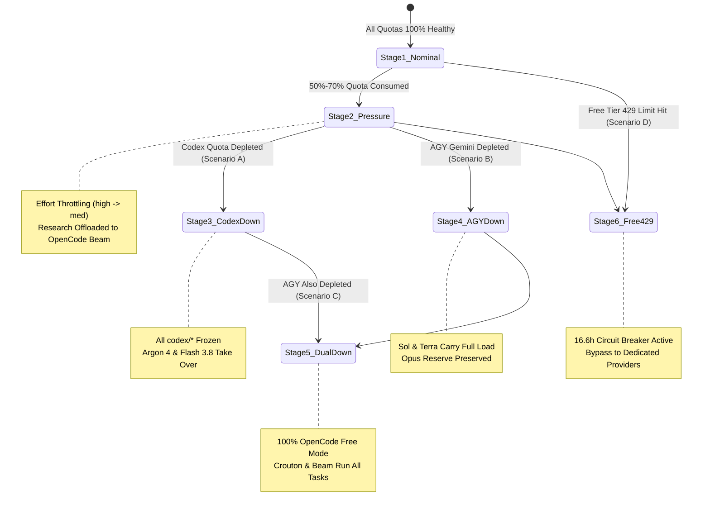

# Epic 3: Multi-Stage Quota Adaptive Circuit Breakers & Fallback Router

**Epic Identifier:** `EPIC-ROUTING-03`  
**Parent Initiative:** Multi-Provider Dynamic Routing Architecture  
**Status:** In Progress / Ready for Development  
**Lead Architect:** Winston (System Architect) & Amelia (Senior Software Engineer)  

---

## 1. Epic Goal & Value Proposition

Provide unbroken operational continuity across erratic provider rate limits, burst depletion, and cloud outages. By deploying an autonomous 5-stage state machine paired with zero-latency circuit breakers, Ahenk MCP ensures that whether OpenAI Codex is exhausted until its weekly reset (Scenario A), Antigravity Gemini bursts are depleted (Scenario B), both commercial providers suffer concurrent blackouts (Scenario C), or OpenCode Free encounters a 16.6-hour community limit (Scenario D), tasks automatically downshift effort and shift traffic to eligible survivors without user interruption or failed builds.



---

## 2. Stories Breakdown

### Story 3.1: 5-Stage Adaptive State Machine & Throttle Policy

**User Story:**
> **As an** Ahenk MCP Orchestrator,  
> **I want to** evaluate system quota health across the 5 predefined operational stages and dynamically adjust effort and task allocation,  
> **So that** token consumption is systematically restrained before exhausting provider allowances.

**Acceptance Criteria (Gherkin):**

```gherkin
Feature: 5-Stage Adaptive State Machine

  Scenario: Stage 1 Nominal Baseline Operation
    Given all 4 provider quota bars have health >= 0.70
    When routing decisions are computed
    Then Stage 1 is active
    And Codex Pro handles coding (Sol) and debugging (Terra) at high/medium effort
    And Google AI Pro handles code review (Flash), architecture (Opus), and planning (Argon).

  Scenario: Stage 2 Medium Pressure Effort Throttling
    Given Codex 5h burst or AGY Gemini pool usage is between 50% and 70%
    When a complex coding task is routed
    Then Stage 2 is active
    And reasoning effort for gpt-6.1-sol or gemini-4-argon is throttled from "high" to "medium"
    And research tasks are offloaded from gpt-6-luna to opencode/beam-free.

  Scenario: Stage 3 Scenario A - Codex Depleted Handover
    Given Codex weekly or 5h burst quota is exhausted (health = 0.0)
    When coding or debugging tasks are submitted
    Then Stage 3 is active
    And all codex/* candidates are marked unavailable
    And gemini-4-argon automatically assumes Primary for coding and debugging.
```

**Technical Specifications:**
- **Files Modified:**
  - `internal/orchestration/capacity_policy.go`
  - `internal/orchestration/engine.go`
- **State Machine Operational Stages:**
  ```go
  type OperationalStage int
  const (
      Stage1Nominal OperationalStage = 1 + iota
      Stage2MediumPressure
      Stage3CodexExhausted
      Stage4AGYExhausted
      Stage5DualCloudOutage
      Stage6FreeTier429
  )
  ```
- **Transition Invariants:** Stage transitions evaluate immediately upon each incoming job or quota refresh cycle and require zero external configuration changes.

**Testing Scenarios:**
- Automated state transition unit tests stepping through Stage 1 $\to$ 2 $\to$ 3 $\to$ 5 and asserting resulting candidate selections.
- Metric assertions verifying token savings in Stage 2 benchmark simulations.

---

### Story 3.2: Zero-Latency Circuit Breakers & Cooldown Window Management

**User Story:**
> **As an** Orchestration Engine,  
> **I want to** immediately trip a circuit breaker upon receiving an HTTP 429 or rate limit response from a provider,  
> **So that** subsequent subagent calls do not make failing network requests during the cooldown window.

**Acceptance Criteria (Gherkin):**

```gherkin
Feature: Zero-Latency Circuit Breaker

  Scenario: Tripping provider circuit breaker on 429
    Given an active task attempt targeting "codex/gpt-6.1-sol"
    When the provider returns HTTP 429 with retry-after header
    Then the circuit breaker for provider "codex" transitions to OPEN
    And the cooldown timestamp is recorded in the in-memory cooldown table
    And the failed job attempt immediately re-routes to fallback #1 (gemini-4-argon) with 0ms added delay.

  Scenario: Fast rejection while circuit breaker is OPEN
    Given the circuit breaker for provider "codex" is OPEN with cooldown remaining
    When a new task arrives with preferred_provider "codex"
    Then the router skips codex models without attempting a network call
    And logs reason "CIRCUIT_BREAKER_OPEN".

  Scenario: Half-Open trial upon cooldown expiration
    Given the circuit breaker for provider "codex" has passed its cooldown deadline
    When a new task is routed
    Then the breaker transitions to HALF_OPEN
    And allows a single probe attempt to test provider health.
```

**Technical Specifications:**
- **Files Modified:**
  - `internal/orchestration/quota.go`
  - `internal/orchestration/engine.go`
- **Circuit Breaker States:** `CLOSED`, `OPEN`, `HALF_OPEN`.
- **Failover Execution:** In-memory map `cooldown map[string]time.Time` guarded by `e.mu`. Checked during candidate iteration in `Engine.route()`.

**Testing Scenarios:**
- Unit test mocking a 429 response and checking that next dispatch skips the tripped provider.
- Test cooldown expiry allowing probe request in `HALF_OPEN` state.

---

### Story 3.3: Dual Cloud Outage Resiliency & Free-Tier 429 Bypass Routing

**User Story:**
> **As a** Developer using Ahenk MCP,  
> **I want** the system to automatically fall back to the OpenCode Free cluster during dual cloud blackouts, and instantly bypass the Free cluster when its 16.6h shared limit is hit,  
> **So that** development work continues uninterrupted without manual intervention.

**Acceptance Criteria (Gherkin):**

```gherkin
Feature: Dual Cloud Outage & Free Tier 429 Bypass

  Scenario: Dual Cloud Outage (Scenario C)
    Given both Codex Pro and Antigravity Gemini burst quotas are exhausted (health = 0.0)
    When coding, debugging, review, and architecture jobs are submitted
    Then all jobs are routed to the OpenCode Free cluster
    And coding/debugging are handled by "opencode/crouton-alpha-free" and "opencode/beam-free"
    And review is handled by "opencode/deepseek-v4.1-flash-free"
    And no error is returned to the user.

  Scenario: OpenCode Free 429 Lockout & Instant Bypass (Scenario D)
    Given OpenCode Free returns "provider.free-limit" (HTTP 429)
    When the circuit breaker triggers
    Then all opencode/* models are placed on a 16.6-hour cooldown
    And any pending or new jobs are immediately routed to available commercial providers (Codex Pro or Antigravity)
    And no subagent attempts are dispatched to OpenCode during the 16.6-hour window.
```

**Technical Specifications:**
- **Files Modified:**
  - `internal/orchestration/opencode_health.go`
  - `internal/orchestration/engine.go`
  - `internal/store/opencode_cooldown.go`
- **OpenCode Cooldown Invariants:** When `provider.free-limit` is detected, set `RetryAfterMS` to $59,760,000\text{ ms}$ ($16.6\text{ hours}$) and persist the cooldown state across restarts in SQLite.

**Testing Scenarios:**
- Simulation of Stage 5 dual-outage routing all 7 categories to OpenCode models with 100% test pass rate in isolated worktrees.
- Unit test for OpenCode 429 response asserting 16.6-hour gate and instantaneous reroute back to dedicated tiers.
