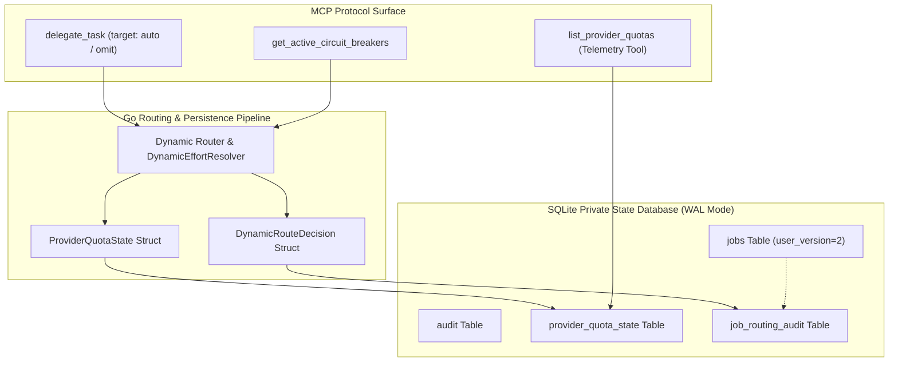

# Epic 4: Ahenk MCP Go State & SQLite Persistence Architecture

**Epic Identifier:** `EPIC-ROUTING-04`  
**Parent Initiative:** Multi-Provider Dynamic Routing Architecture  
**Status:** In Progress / Ready for Development  
**Lead Architect:** Winston (System Architect) & Amelia (Senior Software Engineer)  

---

## 1. Epic Goal & Value Proposition

Provide durable, crash-resilient persistence for quota telemetry and routing decisions while seamlessly exposing dynamic routing capabilities through the MCP protocol. By extending Ahenk's local SQLite storage with dedicated `provider_quota_state` and `job_routing_audit` tables and wiring the `DynamicRouteDecision` pipeline directly into `delegate_task`, Ahenk ensures full auditability of AI decisions, preserves cooldown states across process restarts, and allows controllers to inspect live provider telemetry transparently.



---

## 2. Stories Breakdown

### Story 4.1: Go Data Structures & SQLite Schema Migration

**User Story:**
> **As an** Ahenk Backend Engineer,  
> **I want to** define Go types (`ProviderTier`, `DynamicRouteDecision`, `ProviderQuotaState`) and implement a forward-compatible SQLite migration to schema version 2,  
> **So that** quota levels, circuit breaker timeouts, and dispatch audit logs are persisted durably and resist process restarts.

**Acceptance Criteria (Gherkin):**

```gherkin
Feature: SQLite Schema Migration & Data Models

  Scenario: Upgrading database to user_version 2
    Given an existing SQLite state database at user_version 1
    When Store.init() is executed
    Then PRAGMA user_version is upgraded to 2
    And table "provider_quota_state" is created with primary key provider_id
    And table "job_routing_audit" is created with foreign key to jobs(id)
    And WAL journal mode and busy_timeout=5000 remain enforced.

  Scenario: Persisting provider quota state across restarts
    Given provider "codex" has a 5-hour window with 25% health and circuit state "CLOSED"
    When the quota state is saved to "provider_quota_state"
    And the Ahenk process restarts and opens the database
    Then the restored quota state matches the persisted health and window duration.

  Scenario: Recording immutable job routing audit trail
    Given a job routed to "antigravity/gemini-4-argon" with effort "medium" and reason "CODEX_EXHAUSTED"
    When the dispatch completes
    Then a record is inserted into "job_routing_audit"
    And all decision metadata (attempt, latency, quota pressure) is retrievable.
```

**Technical Specifications:**
- **Files Modified / Created:**
  - `internal/model/model.go`
  - `internal/store/store.go`
  - `internal/store/store_test.go`
- **Go Type Definitions:**
  ```go
  package model

  import "time"

  type ProviderTier string

  const (
      TierCodexPro  ProviderTier = "codex_pro"
      TierAgyPro    ProviderTier = "agy_google_ai_pro"
      TierOpenFree  ProviderTier = "opencode_free"
  )

  type DynamicRouteDecision struct {
      TaskID         string       `json:"task_id"`
      SelectedModel  string       `json:"selected_model"`
      Provider       string       `json:"provider"`
      Tier           ProviderTier `json:"tier"`
      ResolvedEffort string       `json:"resolved_effort"` // low, medium, high
      CircuitOpen    bool         `json:"circuit_open"`
      QuotaHealthPct float64      `json:"quota_health_pct"`
      FallbackStack  []string     `json:"fallback_stack"`
      EvaluatedAt    time.Time    `json:"evaluated_at"`
  }

  type ProviderQuotaState struct {
      ProviderID            string       `json:"provider_id"`
      TierName              ProviderTier `json:"tier_name"`
      WindowDurationHours   float64      `json:"window_duration_hours"`
      RequestsUsedInWindow  int          `json:"requests_used_in_window"`
      MaxWindowRequests     int          `json:"max_window_requests"`
      HealthPct             float64      `json:"health_pct"`
      CircuitState          string       `json:"circuit_state"` // CLOSED, OPEN, HALF_OPEN
      RetryAfterUTC         *time.Time   `json:"retry_after_utc,omitempty"`
      UpdatedAt             time.Time    `json:"updated_at"`
  }
  ```
- **DDL Migration (user_version 2):**
  ```sql
  CREATE TABLE IF NOT EXISTS provider_quota_state (
      provider_id TEXT PRIMARY KEY,
      tier_name TEXT NOT NULL,
      window_duration_hours REAL NOT NULL,
      requests_used_in_window INTEGER NOT NULL DEFAULT 0,
      max_window_requests INTEGER NOT NULL,
      health_pct REAL NOT NULL DEFAULT 1.0,
      circuit_state TEXT NOT NULL DEFAULT 'CLOSED',
      retry_after_utc TIMESTAMP,
      updated_at TIMESTAMP NOT NULL DEFAULT CURRENT_TIMESTAMP
  );

  CREATE TABLE IF NOT EXISTS job_routing_audit (
      job_id TEXT NOT NULL REFERENCES jobs(id) ON DELETE CASCADE,
      task_category TEXT NOT NULL,
      attempt_number INTEGER NOT NULL DEFAULT 1,
      assigned_model TEXT NOT NULL,
      assigned_effort TEXT NOT NULL,
      route_reason TEXT NOT NULL,
      quota_pressure_at_dispatch REAL NOT NULL,
      dispatch_status TEXT NOT NULL,
      latency_ms INTEGER,
      created_at TIMESTAMP NOT NULL DEFAULT CURRENT_TIMESTAMP,
      PRIMARY KEY (job_id, attempt_number)
  );

  CREATE INDEX IF NOT EXISTS idx_routing_audit_created ON job_routing_audit(created_at);
  PRAGMA user_version = 2;
  ```

**Testing Scenarios:**
- Unit test for migration from v1 database file to v2 schema without data loss.
- High-concurrency write test ensuring WAL mode prevents `database is locked` errors during concurrent job auditing.

---

### Story 4.2: MCP `delegate_task` Target Auto-Resolution & Audit Logging

**User Story:**
> **As an** AI agent calling `delegate_task`,  
> **I want** omitting the `target` parameter (or specifying `provider: "auto"`) to automatically resolve the optimal provider, model, and reasoning effort,  
> **So that** subagents don't need hardcoded model names and will automatically benefit from dynamic quota load balancing.

**Acceptance Criteria (Gherkin):**

```gherkin
Feature: delegate_task Dynamic Target Resolution

  Scenario: delegate_task without explicit target routes automatically
    Given a delegate_task tool call with objective "Implement O(N log N) interval search"
    And target is omitted
    When the MCP server processes the tool call
    Then the task is classified as category "coding"
    And DynamicRouter selects primary engine "codex/gpt-6.1-sol" with resolved effort "high"
    And the returned job response contains target metadata in RouteDecision.

  Scenario: Explicit model request is respected if available
    Given a delegate_task tool call with explicit target model "gemini-4-argon"
    When the candidate route is evaluated
    Then "gemini-4-argon" is selected directly
    And DynamicEffortResolver computes the effort for the requested model.

  Scenario: Routing decision logged in audit trail
    Given a successful delegate_task execution
    When job completion is verified
    Then a corresponding record exists in "job_routing_audit" table
    And specifies assigned_model, assigned_effort, and quota_pressure_at_dispatch.
```

**Technical Specifications:**
- **Files Modified:**
  - `internal/mcpserver/server.go`
  - `internal/orchestration/engine.go`
  - `internal/model/model.go`
- **Schema Mapping:** Extend `DelegateTaskInput` to populate `DynamicRouteDecision` into the job metadata.
- **Backwards Compatibility:** All existing arguments (`task`, `objective`, `isolation`, `mode`) remain 100% backward-compatible.

**Testing Scenarios:**
- End-to-end MCP protocol test calling `delegate_task` via JSON-RPC with `{ task: "..." }` and verifying returned routing decision fields.
- Verification that audit trail records accurately capture dispatch status (`SUCCESS`, `FAILED_429`).

---

### Story 4.3: Real-Time Quota Telemetry Inspection MCP Tools & Diagnostics API

**User Story:**
> **As an** IDE controller or supervising developer,  
> **I want** dedicated MCP inspection tools to view live quota bars, active circuit breakers, and recent routing decisions,  
> **So that** I have full visibility into provider health and understand why specific models or effort levels were chosen.

**Acceptance Criteria (Gherkin):**

```gherkin
Feature: Quota Diagnostics MCP Tools

  Scenario: Inspecting quota telemetry via MCP
    When the controller calls the MCP tool "get_provider_quotas"
    Then the response returns the status of all 4 bars:
      | Bar | Provider | Health | Window | Circuit |
      | Bar 1 | Codex Pro | 0.00 | 5h/Weekly | OPEN |
      | Bar 2 | AGY Gemini | 0.85 | 5h | CLOSED |
      | Bar 3 | AGY Opus | 0.60 | 5-Day | CLOSED |
      | Bar 4 | OpenCode Free | 1.00 | 16.6h | CLOSED |

  Scenario: Inspecting active circuit breakers
    Given the circuit breaker for provider "codex" is OPEN until Nov 16th
    When the controller calls "get_active_circuit_breakers"
    Then the response returns an array containing:
      | Provider | Scope | Code | Until |
      | codex | provider | COOLDOWN | 2026-11-16T00:00:00Z |
```

**Technical Specifications:**
- **Files Modified:**
  - `internal/mcpserver/server.go`
  - `internal/orchestration/quota.go`
- **New MCP Tool Registrations:**
  - `get_provider_quotas`: Returns normalized 4-bar quota telemetry.
  - `get_active_circuit_breakers`: Returns all currently open circuit breakers and cooldown timers.
  - `get_routing_audit`: Returns recent dynamic routing decisions for a specific job ID.

**Testing Scenarios:**
- MCP JSON-RPC call tests verifying schema validation and output structure.
- Asserting zero latency overhead on scheduling when telemetry tools are polled concurrently.
