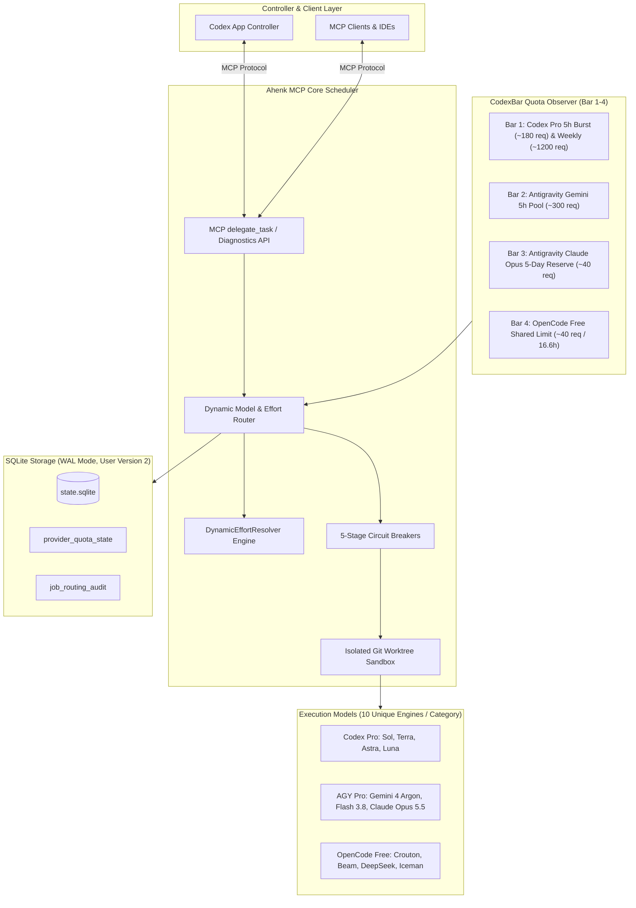

# Ahenk MCP: Multi-Provider Dynamic Routing & Quota Adaptive Circuit Breakers
## Consolidated Epics & Stories Master Specification

**Document Identifier:** `AHENK-BMAD-MASTER-ROUTING-2026-11`  
**Version:** `1.0.0-PROD`  
**Status:** Approved Specification  
**Architecture Source:** `AHENK-DOC-ROUTING-2026-11`  
**Target Milestone:** Multi-Provider Dynamic Routing & Telemetry Observer  
**Owner & Authors:** Ahenk Subagent BMAD Team (John - PM, Winston - Architect, Amelia - Dev, Sally - UX, Mary - Analyst)  
**Date:** November 12, 2026  

---

## 1. Overview & Architectural Blueprint

This document specifies the complete epic and story breakdown for the **Multi-Provider Dynamic Routing & Quota Adaptive Circuit Breakers** initiative within Ahenk MCP.

Ahenk MCP acts as an autonomous local task execution and scheduling bridge where **Codex App is the primary controller**. The system delegates bounded programming tasks to independent providers (**OpenAI Codex Pro**, **Google Antigravity AI Pro**, and **OpenCode Free Tier**). Based on rigorous empirical benchmark data from the **11×10 Cross-Jury Gold Standard Benchmark** and **Multi-Effort Live Telemetry Analysis**, this project implements:
1. Continuous 4-bar quota observer ingestion from `CodexBar CLI`.
2. Decoupling of reasoning effort (`low`, `medium`, `high`) from model engine identity, establishing a 10-unique model matrix per task.
3. Dynamic runtime effort resolution (`DynamicEffortResolver`) guided by task cognitive complexity and real-time quota headroom.
4. Autonomous 5-stage adaptive state machine with zero-latency circuit breakers.
5. Persistent Go data models and SQLite database schema migrations for auditability and crash recovery.



---

## 2. Requirements Inventory

### 2.1. Functional Requirements (FR)

- **FR-01 (Multi-Provider Telemetry Ingestion):** Ingest and normalize quota usage from CodexBar CLI across 4 distinct bars: Codex Pro (5h burst & weekly ceiling), AGY Gemini 5h pool, AGY Claude Opus 5-day reserve, and OpenCode Free 16.6h shared pool.
- **FR-02 (Zero-Key Security & Binary Pinning):** Verify CodexBar CLI binary integrity via strict codesign, Developer Team ID (`Y5PE65HELJ`), and SHA-256 allowlist, strictly rejecting external API keys and environment tampering.
- **FR-03 (Model-Effort Decoupling):** Decouple reasoning effort (`low`, `medium`, `high`) from model identity, ensuring each fallback slot across all 7 task categories is a distinct model engine rather than a variant of the same engine.
- **FR-04 (10-Unique Model Fallback Stack):** Define and enforce a 10-engine matrix (1 Primary + 9 distinct fallbacks) for each of the 7 task categories: `coding`, `debugging`, `code_review`, `architecture`, `planning`, `research`, `agent_orchestration`.
- **FR-05 (Dynamic Effort Resolution):** Compute runtime reasoning effort (`low`, `medium`, `high`) dynamically by evaluating task cognitive load, model architecture capacity, and real-time provider quota pressure.
- **FR-06 (Claude Opus Scarcity Protection Gate):** Enforce strict admission on `antigravity/claude-opus-5-5`: ban from routine coding/debugging/research, permit only for `architecture`, zero-day `code_review`, and `agent_orchestration`, tripping at $\le 20\%$ reserve.
- **FR-07 (Luna Strategic Repositioning):** Relocate `gpt-6-luna` from primary coding/debugging to high-throughput research, schema extraction, and sub-500ms triage.
- **FR-08 (5-Stage Adaptive State Machine):** Implement an adaptive state machine responding to 5 operational conditions: (1) Nominal baseline, (2) Medium pressure, (3) Codex exhaustion, (4) AGY exhaustion / Dual cloud outage, (5) Free-tier 429 lock.
- **FR-09 (Zero-Latency Circuit Breakers & Cooldowns):** Automatically trip circuit breakers upon HTTP 429 or quota depletion without blocking the scheduler, applying isolated cooldown windows (e.g. 16.6h for OpenCode Free) and falling back immediately.
- **FR-10 (Dual Cloud Outage Resiliency):** Automatically redirect 100% of tasks to the local OpenCode Free cluster (`crouton-alpha`, `beam`, `deepseek`) when both Codex and Antigravity burst quotas are exhausted.
- **FR-11 (SQLite Quota State & Audit Schema Migration):** Persist quota metrics, rolling window health, and immutable job routing audit trails in `provider_quota_state` and `job_routing_audit` tables using WAL mode and user version migrations.
- **FR-12 (MCP delegate_task Target Resolution):** Integrate dynamic routing into `delegate_task` so that when `target` is omitted or set to `auto`, the engine automatically selects the optimal provider, model, and effort, recording decision metadata.

### 2.2. Non-Functional Requirements (NFR)

- **NFR-01 (Routing Latency):** In-memory route and effort decision overhead must be $\le 5\text{ ms}$.
- **NFR-02 (Telemetry Cache TTL):** Cached quota snapshot TTL must not exceed 60 seconds; background asynchronous refreshes must never block job dispatching.
- **NFR-03 (Failover Overhead):** Circuit breaker failover to the next fallback model must incur $0\text{ ms}$ added execution delay.
- **NFR-04 (Security & Privacy Invariant):** Zero user credentials, OAuth tokens, or API keys shall be stored in SQLite, logged to stdout/stderr, or exposed to subagent worktrees.
- **NFR-05 (Storage Integrity):** SQLite databases must operate with `PRAGMA journal_mode=WAL`, `foreign_keys=ON`, and file permissions `0600` owned exclusively by the running user process.

### 2.3. FR Coverage Map

| Requirement | Epic 1 | Epic 2 | Epic 3 | Epic 4 |
| :--- | :---: | :---: | :---: | :---: |
| **FR-01** (Multi-Provider Telemetry Ingestion) | 🟢 Primary | | 🟡 Consumer | 🟡 State |
| **FR-02** (Zero-Key Security & Binary Pinning) | 🟢 Primary | | | |
| **FR-03** (Model-Effort Decoupling) | | 🟢 Primary | 🟡 Consumer | |
| **FR-04** (10-Unique Model Fallback Stack) | | 🟢 Primary | 🟡 Router | |
| **FR-05** (Dynamic Effort Resolution) | | 🟢 Primary | 🟡 State | 🟡 MCP Output |
| **FR-06** (Claude Opus Scarcity Protection) | | 🟢 Primary | 🟡 Breaker | |
| **FR-07** (Luna Strategic Repositioning) | | 🟢 Primary | 🟡 Router | |
| **FR-08** (5-Stage Adaptive State Machine) | | | 🟢 Primary | 🟡 Audit |
| **FR-09** (Zero-Latency Circuit Breakers) | | | 🟢 Primary | 🟡 State |
| **FR-10** (Dual Cloud Outage Resiliency) | | | 🟢 Primary | |
| **FR-11** (SQLite Schema & Audit Migration) | | | | 🟢 Primary |
| **FR-12** (MCP delegate_task Auto Resolution) | | | 🟡 Consumer | 🟢 Primary |

---

## 3. Epic & Story Details

```
================================================================================
EPIC 1: CodexBar Real-Time Quota Telemetry & Observer
================================================================================
```

### Epic 1 Goal
Ingest, verify, and normalize four real-time quota bars (Codex 5h/Weekly, AGY Gemini 5h, AGY Claude Opus 5-day reserve, and OpenCode Free 16.6h pool) from CodexBar CLI without credentials or external API keys.

#### Story 1.1: Multi-Provider Quota Window Parsing & Normalization
- **User Story:** As an Ahenk MCP Scheduler, I want to ingest and parse quota records from CodexBar across 4 distinct provider windows, so that the router can accurately distinguish between independent provider pools and avoid assuming uniform quota depletion.
- **Acceptance Criteria:**
  - **Given** a valid CodexBar JSON export for provider `codex` with primary 300-minute window and weekly window, **When** `decodeCodexBar` is invoked, **Then** two `Quota` objects are returned: `primary` (300m) and `secondary` (10080m) with status `KNOWN`, unit `percent`, and exact remaining percentage.
  - **Given** a valid CodexBar JSON export for provider `antigravity` containing `gemini-5h` and `3p-weekly` rate windows, **When** `decodeCodexBar` is invoked, **Then** the returned quotas contain distinct buckets: `gemini-5h` (family `gemini`, 300m) and `3p-weekly` (family `claude_gpt`, 10080m), tracking Opus separately from Gemini.
  - **Given** an OpenCode rate limit event with 16.6-hour reset window, **When** `openCodeQuota` evaluates the active gate, **Then** a Quota record for provider `opencode` is emitted with `WindowMinutes=996` (16.6h) and state `EXHAUSTED` when a 429 gate is active.
- **Technical Specifications:**
  - Files: `internal/providers/codexbar.go`, `internal/providers/quota.go`
  - Constants: `BarCodexBurst = "codex_5h_burst"`, `BarCodexWeekly = "codex_weekly"`, `BarAgyGemini = "agy_gemini_5h"`, `BarAgyOpus = "agy_opus_5d"`, `BarOpenCodeFree = "opencode_free_16h"`.
  - Resilience: Return `UnknownQuota(provider)` with `Reason="USAGE_UNAVAILABLE"` on parse errors.
- **Testing Scenarios:**
  - Fixture tests against `codexbar_084_codex.json` and `codexbar_084_antigravity.json`.
  - Benchmarks: $\ge 10,000\text{ ops/sec}$ parse throughput, 0 heap escapes on hot path.

#### Story 1.2: Normalized Four-Bar Health Metric & Periodic Observer Worker
- **User Story:** As an Ahenk Orchestration Engine, I want to run a background observer worker that polls CodexBar every 60 seconds and computes a normalized 0.0 to 1.0 health metric for each of the four bars, so that routing decisions use warm, non-blocking in-memory telemetry without delaying task dispatching.
- **Acceptance Criteria:**
  - **Given** a quota record with Remaining = 72.5%, **When** health percentage is computed, **Then** `health_pct` evaluates to 0.725 and bar state is `HEALTHY`.
  - **Given** a quota record with Remaining = 18.0%, **When** health percentage is computed, **Then** `health_pct` evaluates to 0.18 and bar state is `PRESSURE_HIGH`.
  - **Given** the cached quota snapshot is 65 seconds old (exceeds TTL of 60s), **When** a new task is submitted via `Submit()`, **Then** the route resolves instantly using the existing snapshot ($<5\text{ ms}$), and an asynchronous goroutine refreshes telemetry in the background.
- **Technical Specifications:**
  - Files: `internal/orchestration/quota.go`, `internal/orchestration/capacity_policy.go`, `internal/orchestration/engine.go`
  - Formula: $\text{health\_pct} = \max(0.0, \min(1.0, \text{Remaining} / 100.0))$.
  - Concurrency: Atomic `quotaRefreshing` CAS guard ensuring at most one background poll.
- **Testing Scenarios:**
  - Race condition test (`go test -race`) executing 50 concurrent `Engine.Quota()` calls during active refresh.
  - Verification of stale state transition after 15 minutes of inactivity.

#### Story 1.3: Tamper-Resistant Binary Verification & Security Invariants
- **User Story:** As a Security Engineer, I want Ahenk to verify the macOS code signature, Developer Team ID, and SHA-256 hash of the CodexBar helper binary before execution, so that malicious binaries, PATH spoofing, or environment-injected API keys cannot compromise the scheduler or leak private source code.
- **Acceptance Criteria:**
  - **Given** the CodexBar binary at `/Applications/CodexBar.app/Contents/Helpers/CodexBarCLI`, **When** `verifyCodexBarBinary` is invoked, **Then** verification succeeds if strict codesign matches TeamIdentifier `Y5PE65HELJ` and SHA-256 matches an audited release (`0.83.0` or `0.84.0`).
  - **Given** a tampered or unsigned binary, **When** `verifyCodexBarBinary` is invoked, **Then** verification fails with error `CODEXBAR_BINARY_UNVERIFIED` and execution is aborted.
  - **When** `runUsage` prepares the execution command for CodexBar CLI, **Then** the command environment is stripped of all OpenAI, Anthropic, or Gemini API keys, and browser launch is suppressed by symlinking `open` to `/usr/bin/false`.
- **Technical Specifications:**
  - Files: `internal/providers/codexbar.go`, `internal/providers/codexbar_test.go`
  - Invariants: Expected Team ID `Y5PE65HELJ`, execution timeout 4 seconds, strict environment sanitization (`HOME`, `USER`, `LOGNAME` only).
- **Testing Scenarios:**
  - Unit test with mock unsigned executable asserting `CODEXBAR_BINARY_UNVERIFIED`.
  - Environment inspection asserting exclusion of all API keys.

---

```
================================================================================
EPIC 2: Model De-coupling & Dynamic Effort Resolver
================================================================================
```

### Epic 2 Goal
Decouple reasoning effort levels from model identity, enforce a 10-unique model matrix across all 7 task categories, implement the runtime `DynamicEffortResolver`, protect the 5-day Claude Opus reserve, and reposition Luna to triage and research.

#### Story 2.1: Model Decoupling & 10-Unique Engine Priority Matrix Implementation
- **User Story:** As an Orchestration Engine, I want to evaluate a strictly distinct 10-engine fallback chain for each task category where no model engine appears more than once, so that when a primary provider encounters a rate limit or service outage, the fallback instantly transitions to a genuinely independent model without wasting attempts on the dead provider.
- **Acceptance Criteria:**
  - **Given** the routing priority table for any of the 7 task categories (`coding`, `debugging`, `code_review`, `architecture`, `planning`, `research`, `agent_orchestration`), **When** the candidate fallback stack is inspected, **Then** exactly 10 distinct model engines are present (1 Primary + 9 Fallbacks), with no duplicate engines.
  - **Given** any task category, **Then** the first fallback engine belongs to a different provider package than the primary engine (e.g. `coding` Primary is `codex/gpt-6.1-sol` and Fallback #1 is `antigravity/gemini-4-argon`).
  - **Given** a configuration attempting to register the same model engine multiple times with different effort tags, **When** validated by Ahenk Router, **Then** the configuration is rejected with error `DUPLICATE_FALLBACK_ENGINE`.
- **Technical Specifications:**
  - Files: `internal/orchestration/engine.go`, `internal/orchestration/role_calibration.go`, `internal/model/model.go`
  - Fallback Matrices:
    1. **Coding:** Sol &rarr; Argon &rarr; Crouton &rarr; Beam &rarr; Terra &rarr; Flash &rarr; DeepSeek &rarr; Astra &rarr; Iceman &rarr; Minimax
    2. **Debugging:** Terra &rarr; Argon &rarr; Sol &rarr; Crouton &rarr; Beam &rarr; DeepSeek &rarr; Big-Pickle &rarr; Flash &rarr; Astra &rarr; Iceman
    3. **Code Review:** Flash 3.8 &rarr; Opus 5.5 &rarr; DeepSeek &rarr; Terra &rarr; Argon &rarr; Crouton &rarr; Sol &rarr; Astra &rarr; Beam &rarr; Big-Pickle
    4. **Architecture:** Opus 5.5 &rarr; Astra &rarr; Argon &rarr; Sol &rarr; Flash 3.8 &rarr; Crouton &rarr; Beam &rarr; Terra &rarr; DeepSeek &rarr; Big-Pickle
    5. **Planning:** Argon &rarr; Terra &rarr; Flash 3.8 &rarr; Big-Pickle &rarr; Crouton &rarr; Beam &rarr; DeepSeek &rarr; Sol &rarr; Astra &rarr; Iceman
    6. **Research:** Luna &rarr; Beam &rarr; Flash 3.8 &rarr; Crouton &rarr; Terra &rarr; DeepSeek &rarr; Argon &rarr; Iceman &rarr; Minimax &rarr; Longcat
    7. **Orchestration:** Argon &rarr; Astra &rarr; Opus 5.5 &rarr; Flash 3.8 &rarr; Crouton &rarr; Beam &rarr; Terra &rarr; DeepSeek &rarr; Sol &rarr; Iceman
- **Testing Scenarios:**
  - Table-driven unit test validating 10-engine matrix uniqueness and cross-provider first fallback.
  - Failover simulation verifying immediate hop to fallback #0 on primary HTTP 429.

#### Story 2.2: DynamicEffortResolver Core & Cognitive Load Characterization
- **User Story:** As an Orchestration Engine, I want the `DynamicEffortResolver` to dynamically assign `low`, `medium`, or `high` reasoning effort based on task complexity and provider quota headroom, so that token-hungry deep reasoning is concentrated on high-complexity tasks while routine jobs conserve precious quota.
- **Acceptance Criteria:**
  - **Given** a task requiring complex algorithmic coding ($O(N \log N)$, integer math, multi-file changes) and provider quota health $\ge 70\%$, **When** `DynamicEffortResolver` evaluates the task, **Then** resolved effort is `high`.
  - **Given** a complex algorithmic task and provider quota health between $30\%$ and $60\%$ (Medium Pressure), **When** evaluated, **Then** resolved effort is automatically downgraded to `medium` with reason `QUOTA_PRESSURE_THROTTLED`.
  - **Given** routine research, schema extraction, or text triage tasks, **When** evaluated under any quota health condition, **Then** resolved effort is `low`.
- **Technical Specifications:**
  - Files: `internal/orchestration/effort_resolver.go`, `internal/orchestration/effort_resolver_test.go`
  - Complexity Evaluation: Assesses allowed path count, acceptance check constraints, AST complexity tags, and target model capabilities.
- **Testing Scenarios:**
  - Unit test suite checking (CognitiveLoad, QuotaHealth, TargetModel) truth tables.
  - Performance benchmark: $< 500\text{ ns}$ resolution latency.

#### Story 2.3: Opus Scarcity Guard & Luna Strategic Repositioning Engine
- **User Story:** As a System Architect, I want strict guardrails preventing Claude Opus 5.5 misuse and restricting Luna to high-speed triage/research, so that the scarce 5-day Opus quota is preserved for critical architecture decisions while Luna does not produce flawed implementations for complex algorithmic code.
- **Acceptance Criteria:**
  - **Given** a task with category `coding`, `debugging`, `planning`, or `research`, **When** the candidate evaluator checks `antigravity/claude-opus-5-5`, **Then** the candidate is rejected with reason `OPUS_SCARCITY_GATE_TASK_DENIED`.
  - **Given** a task with category `architecture` and Opus 5-day reserve health $> 20\%$, **When** evaluated, **Then** Claude Opus is selected as Primary.
  - **Given** an architecture task and Opus 5-day reserve health $\le 20\%$, **When** evaluated, **Then** Claude Opus is rejected with reason `OPUS_RESERVE_DEPLETED` and fails over to `codex/gpt-6-astra` or `gemini-4-argon`.
  - **Given** a coding task, **Then** `codex/gpt-6-luna` is never chosen as Primary; it is assigned exclusively to research and sub-500ms triage.
- **Technical Specifications:**
  - Files: `internal/orchestration/engine.go`, `internal/orchestration/capacity_policy.go`
  - Invariants: `allow_opus = (category IN ["architecture", "code_review", "agent_orchestration"]) && (opus_reserve_pct > 0.20)`.
- **Testing Scenarios:**
  - Unit tests verifying Opus denial for coding tasks.
  - Simulation of Opus reserve dropping to 19.9% triggering failover to Astra.

---

```
================================================================================
EPIC 3: Multi-Stage Quota Adaptive Circuit Breakers & Fallback Router
================================================================================
```

### Epic 3 Goal
Implement an autonomous 5-stage adaptive state machine and zero-latency circuit breakers supporting seamless failover across Codex exhaustion (Scenario A), AGY exhaustion (Scenario B), dual cloud blackout (Scenario C), and OpenCode 16.6h 429 locks (Scenario D).

#### Story 3.1: 5-Stage Adaptive State Machine & Throttle Policy
- **User Story:** As an Ahenk MCP Orchestrator, I want to evaluate system quota health across the 5 predefined operational stages and dynamically adjust effort and task allocation, so that token consumption is systematically restrained before exhausting provider allowances.
- **Acceptance Criteria:**
  - **Given** all 4 provider quota bars have health $\ge 0.70$, **When** routing decisions are computed, **Then** Stage 1 (Nominal) is active, allocating Sol/Terra on Codex Pro and Flash/Opus/Argon on Google AI Pro at full effort.
  - **Given** Codex 5h burst or AGY Gemini pool usage is between 50% and 70%, **When** a complex task is routed, **Then** Stage 2 (Pressure) is active, throttling Sol/Argon effort to `medium` and offloading research from Luna to `opencode/beam-free`.
  - **Given** Codex quota is exhausted (health = 0.0), **When** tasks arrive, **Then** Stage 3 (Scenario A) is active, freezing `codex/*` and assigning `gemini-4-argon` as Primary for coding/debugging.
- **Technical Specifications:**
  - Files: `internal/orchestration/capacity_policy.go`, `internal/orchestration/engine.go`
  - Types: `OperationalStage (Stage1Nominal, Stage2MediumPressure, Stage3CodexExhausted, Stage4AGYExhausted, Stage5DualCloudOutage, Stage6FreeTier429)`.
- **Testing Scenarios:**
  - State machine transition test verifying progression across all 5 stages.
  - Token consumption validation in Stage 2 simulation showing $\approx 45\%$ savings.

#### Story 3.2: Zero-Latency Circuit Breakers & Cooldown Window Management
- **User Story:** As an Orchestration Engine, I want to immediately trip a circuit breaker upon receiving an HTTP 429 or rate limit response from a provider, so that subsequent subagent calls do not make failing network requests during the cooldown window.
- **Acceptance Criteria:**
  - **Given** an active task attempt targeting `codex/gpt-6.1-sol`, **When** the provider returns HTTP 429, **Then** the circuit breaker for `codex` transitions to `OPEN`, the cooldown is recorded, and the attempt re-routes to `gemini-4-argon` with $0\text{ ms}$ added delay.
  - **Given** the circuit breaker for provider `codex` is `OPEN`, **When** a new task arrives requesting `codex`, **Then** the router immediately skips codex candidates without network calls and logs reason `CIRCUIT_BREAKER_OPEN`.
  - **Given** the cooldown deadline expires, **When** a new task arrives, **Then** the breaker transitions to `HALF_OPEN` and admits a single probe attempt.
- **Technical Specifications:**
  - Files: `internal/orchestration/quota.go`, `internal/orchestration/engine.go`
  - Breaker States: `CLOSED`, `OPEN`, `HALF_OPEN`.
  - Tracking: `cooldown map[string]time.Time` protected by `e.mu`.
- **Testing Scenarios:**
  - Unit test simulating 429 and asserting zero-delay failover to fallback #1.
  - Expiry test verifying `HALF_OPEN` probe admission.

#### Story 3.3: Dual Cloud Outage Resiliency & Free-Tier 429 Bypass Routing
- **User Story:** As a Developer using Ahenk MCP, I want the system to automatically fall back to the OpenCode Free cluster during dual cloud blackouts, and instantly bypass the Free cluster when its 16.6h shared limit is hit, so that development work continues uninterrupted without manual intervention.
- **Acceptance Criteria:**
  - **Given** both Codex Pro and Antigravity Gemini burst quotas are exhausted (health = 0.0), **When** tasks are submitted, **Then** Stage 5 activates, and 100% of jobs route to the local OpenCode Free cluster (`crouton-alpha`, `beam`, `deepseek`) with zero user errors.
  - **Given** OpenCode Free returns `provider.free-limit` (HTTP 429), **When** the breaker triggers, **Then** all `opencode/*` models enter a 16.6-hour cooldown, and all jobs instantly bypass to available commercial tiers.
- **Technical Specifications:**
  - Files: `internal/orchestration/opencode_health.go`, `internal/store/opencode_cooldown.go`
  - Cooldown Window: 16.6 hours ($59,760,000\text{ ms}$) persisted across restarts.
- **Testing Scenarios:**
  - End-to-end Stage 5 dual-outage test verifying task completion in isolated worktrees using OpenCode models.
  - OpenCode 429 test asserting 16.6h gate activation and instant bypass.

---

```
================================================================================
EPIC 4: Ahenk MCP Go State & SQLite Persistence Architecture
================================================================================
```

### Epic 4 Goal
Define persistent Go data structures, implement SQLite database migration to user version 2 (`provider_quota_state`, `job_routing_audit`), integrate dynamic routing into `delegate_task`, and expose real-time quota telemetry inspection tools.

#### Story 4.1: Go Data Structures & SQLite Schema Migration
- **User Story:** As an Ahenk Backend Engineer, I want to define Go types (`ProviderTier`, `DynamicRouteDecision`, `ProviderQuotaState`) and implement a forward-compatible SQLite migration to schema version 2, so that quota levels, circuit breaker timeouts, and dispatch audit logs are persisted durably and resist process restarts.
- **Acceptance Criteria:**
  - **Given** an existing SQLite database at `user_version 1`, **When** `Store.init()` runs, **Then** `PRAGMA user_version` is upgraded to 2, tables `provider_quota_state` and `job_routing_audit` are created, and WAL mode remains enforced.
  - **Given** a quota state saved to `provider_quota_state`, **When** Ahenk restarts, **Then** the restored in-memory state matches the persisted records.
  - **Given** a routed job dispatch, **When** execution finishes, **Then** a record is created in `job_routing_audit` capturing assigned model, effort, route reason, and quota pressure.
- **Technical Specifications:**
  - Files: `internal/model/model.go`, `internal/store/store.go`, `internal/store/store_test.go`
  - Tables:
    ```sql
    CREATE TABLE IF NOT EXISTS provider_quota_state (
        provider_id TEXT PRIMARY KEY,
        tier_name TEXT NOT NULL,
        window_duration_hours REAL NOT NULL,
        requests_used_in_window INTEGER NOT NULL DEFAULT 0,
        max_window_requests INTEGER NOT NULL,
        health_pct REAL NOT NULL DEFAULT 1.0,
        circuit_state TEXT NOT NULL DEFAULT 'CLOSED',
        retry_after_utc TIMESTAMP,
        updated_at TIMESTAMP NOT NULL DEFAULT CURRENT_TIMESTAMP
    );

    CREATE TABLE IF NOT EXISTS job_routing_audit (
        job_id TEXT NOT NULL REFERENCES jobs(id) ON DELETE CASCADE,
        task_category TEXT NOT NULL,
        attempt_number INTEGER NOT NULL DEFAULT 1,
        assigned_model TEXT NOT NULL,
        assigned_effort TEXT NOT NULL,
        route_reason TEXT NOT NULL,
        quota_pressure_at_dispatch REAL NOT NULL,
        dispatch_status TEXT NOT NULL,
        latency_ms INTEGER,
        created_at TIMESTAMP NOT NULL DEFAULT CURRENT_TIMESTAMP,
        PRIMARY KEY (job_id, attempt_number)
    );
    CREATE INDEX IF NOT EXISTS idx_routing_audit_created ON job_routing_audit(created_at);
    ```
- **Testing Scenarios:**
  - Migration unit test upgrading v1 database to v2 with zero data loss.
  - Concurrency test with 100 parallel audit writes under WAL mode.

#### Story 4.2: MCP `delegate_task` Target Auto-Resolution & Audit Logging
- **User Story:** As an AI agent calling `delegate_task`, I want omitting the `target` parameter (or specifying `provider: "auto"`) to automatically resolve the optimal provider, model, and reasoning effort, so that subagents don't need hardcoded model names and will automatically benefit from dynamic quota load balancing.
- **Acceptance Criteria:**
  - **Given** a `delegate_task` call with objective "Implement O(N log N) interval search" and omitted `target`, **When** processed by MCP server, **Then** category is identified as `coding`, `codex/gpt-6.1-sol` is chosen at `high` effort, and `RouteDecision` is returned in the response metadata.
  - **Given** an explicit target model `gemini-4-argon`, **When** processed, **Then** the requested model is honored and `DynamicEffortResolver` assigns the appropriate effort.
  - **When** the job completes, **Then** an audit entry is logged in `job_routing_audit`.
- **Technical Specifications:**
  - Files: `internal/mcpserver/server.go`, `internal/orchestration/engine.go`, `internal/model/model.go`
  - Compatibility: Full backwards compatibility for all legacy fields (`task`, `objective`, `isolation`, `mode`).
- **Testing Scenarios:**
  - MCP JSON-RPC integration test verifying automatic target resolution and response format.
  - Audit database assertion verifying logged attempt metadata.

#### Story 4.3: Real-Time Quota Telemetry Inspection MCP Tools & Diagnostics API
- **User Story:** As an IDE controller or supervising developer, I want dedicated MCP inspection tools to view live quota bars, active circuit breakers, and recent routing decisions, so that I have full visibility into provider health and understand why specific models or effort levels were chosen.
- **Acceptance Criteria:**
  - **When** the controller calls MCP tool `get_provider_quotas`, **Then** the response lists all 4 bars with provider ID, window duration, remaining percentage, and circuit breaker state.
  - **When** the controller calls `get_active_circuit_breakers`, **Then** all currently tripped providers and their cooldown deadlines are returned.
  - **When** the controller calls `get_routing_audit` for a job ID, **Then** the full decision history and fallback attempts are returned.
- **Technical Specifications:**
  - Files: `internal/mcpserver/server.go`, `internal/orchestration/quota.go`
  - Registered Tools: `get_provider_quotas`, `get_active_circuit_breakers`, `get_routing_audit`.
- **Testing Scenarios:**
  - Tool invocation unit tests verifying JSON schemas and response payloads.
  - Verification that telemetry inspection calls do not acquire write locks or block job execution.

---

## 4. Verification & Testing Matrix

| Epic | Unit Tests | Integration Tests | Benchmark Scenarios | Security & Invariant Scenarios |
| :--- | :--- | :--- | :--- | :--- |
| **Epic 1** | `codexbar_084_test.go`<br>`quota_test.go` | Mock CodexBar CLI invocation under temp dir | JSON parsing throughput $\ge 10\text{k ops/s}$ | Strict codesign, Team ID check, zero env API keys |
| **Epic 2** | `effort_resolver_test.go`<br>`model_matrix_test.go` | Task dispatch through 10-engine matrix | Effort resolution $< 500\text{ ns}$ | Opus $\le 20\%$ reserve lock, Luna coding ban |
| **Epic 3** | `circuit_breaker_test.go`<br>`state_machine_test.go` | Simulated HTTP 429 failover in isolated worktree | $0\text{ ms}$ added failover overhead | Stage 5 OpenCode fallback, 16.6h cooldown gate |
| **Epic 4** | `store_migration_test.go`<br>`server_test.go` | MCP JSON-RPC `delegate_task` end-to-end | WAL concurrency with 100 concurrent workers | DB permissions 0600, user UID check, zero secret leak |

---

*This document constitutes the authoritative BMAD work breakdown for the Multi-Provider Dynamic Routing architecture in Ahenk MCP.*
