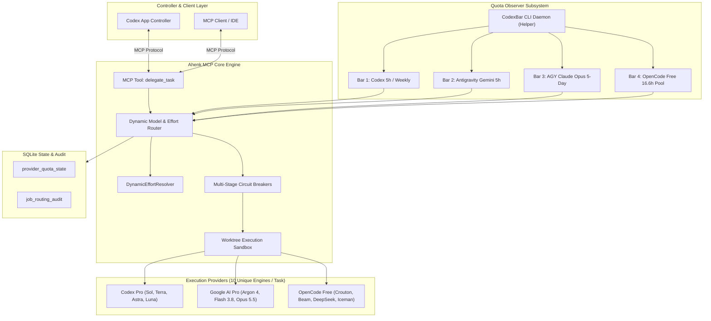

# Ahenk MCP: Multi-Provider Dynamic Routing & Quota Adaptive Circuit Breakers
## Epic & Story Master Overview

**Document Identifier:** `AHENK-BMAD-EPIC-ROUTING-2026-11`  
**Status:** Approved Specification  
**Architecture Baseline:** `AHENK-DOC-ROUTING-2026-11`  
**Target Milestone:** Multi-Provider Dynamic Routing & Telemetry Observer  
**Owner & Authors:** Ahenk Architecture Subagent & Product Strategy Team  
**Date:** November 12, 2026  

---

## 1. Executive Summary & Vision

Ahenk MCP acts as a local autonomous task orchestrator and scheduler for AI developer agents, with **Codex App serving as the primary controller**. Its core responsibility is scheduling subagent tasks, dynamically matching jobs to optimal AI provider models and execution efforts based on real-time quota telemetry, executing tasks in isolated Git worktrees, and delivering verified diffs and test evidence back to the controller.

Following the empirical findings of the **11×10 Cross-Jury Gold Standard Benchmark** and **Multi-Effort Live Telemetry Analysis**, this project implements an adaptive, decoupled routing engine. The system moves away from static model lists and naive fallback chains towards a continuous 4-bar quota observer, decoupled dynamic reasoning effort resolution (`low`, `medium`, `high`), and multi-stage circuit breakers capable of zero-downtime failover across **OpenAI Codex Pro**, **Google Antigravity AI Pro**, and **OpenCode Free Tier**.



---

## 2. Requirements Inventory

### 2.1. Functional Requirements (FR)

| FR ID | Requirement Name | Description | Target Epic |
| :--- | :--- | :--- | :--- |
| **FR-01** | Multi-Provider Quota Telemetry Ingestion | Ingest and normalize quota usage from CodexBar CLI across 4 distinct bars: Codex Pro (5h burst & weekly ceiling), AGY Gemini 5h pool, AGY Claude Opus 5-day reserve, and OpenCode Free 16.6h shared pool. | Epic 1 |
| **FR-02** | Zero-Key Quota Integrity & Codesign Pinning | Verify CodexBar CLI binary integrity via strict codesign, team ID (`Y5PE65HELJ`), and SHA-256 allowlist, strictly rejecting external API keys and environment tampering. | Epic 1 |
| **FR-03** | Model-Effort Decoupling | Decouple reasoning effort (`low`, `medium`, `high`) from model identity, ensuring each fallback slot across all 7 task categories is a distinct model engine rather than a variant of the same engine. | Epic 2 |
| **FR-04** | 10-Unique Model Fallback Stack | Define and enforce a 10-engine matrix (1 Primary + 9 distinct fallbacks) for each of the 7 task categories: `coding`, `debugging`, `code_review`, `architecture`, `planning`, `research`, `agent_orchestration`. | Epic 2 |
| **FR-05** | Dynamic Effort Resolution (`DynamicEffortResolver`) | Compute runtime reasoning effort (`low`, `medium`, `high`) dynamically by evaluating task cognitive load, model architecture capacity, and real-time provider quota pressure. | Epic 2 |
| **FR-06** | Claude Opus Scarcity Protection Gate | Enforce strict admission on `antigravity/claude-opus-5-5`: ban from routine coding/debugging/research, permit only for `architecture`, zero-day `code_review`, and `agent_orchestration`, tripping at $\le 20\%$ reserve. | Epic 2 |
| **FR-07** | Luna Strategic Repositioning | Relocate `gpt-6-luna` from primary coding/debugging to high-throughput research, schema extraction, and sub-500ms triage. | Epic 2 |
| **FR-08** | 5-Stage Adaptive State Machine | Implement an adaptive state machine responding to 5 operational conditions: (1) Nominal baseline, (2) Medium pressure, (3) Codex exhaustion, (4) AGY exhaustion / Dual cloud outage, (5) Free-tier 429 lock. | Epic 3 |
| **FR-09** | Zero-Latency Circuit Breakers & Cooldowns | Automatically trip circuit breakers upon HTTP 429 or quota depletion without blocking the scheduler, applying isolated cooldown windows (e.g. 16.6h for OpenCode Free) and falling back immediately. | Epic 3 |
| **FR-10** | Dual Cloud Outage Resiliency | Automatically redirect 100% of tasks to the local OpenCode Free cluster (`crouton-alpha`, `beam`, `deepseek`) when both Codex and Antigravity burst quotas are exhausted. | Epic 3 |
| **FR-11** | SQLite Quota State & Audit Schema Migration | Persist quota metrics, rolling window health, and immutable job routing audit trails in `provider_quota_state` and `job_routing_audit` tables using WAL mode and user version migrations. | Epic 4 |
| **FR-12** | MCP `delegate_task` Target Resolution | Integrate dynamic routing into `delegate_task` so that when `target` is omitted or set to `auto`, the engine automatically selects the optimal provider, model, and effort, recording decision metadata. | Epic 4 |

### 2.2. Non-Functional Requirements (NFR)

| NFR ID | Category | Requirement Detail |
| :--- | :--- | :--- |
| **NFR-01** | Routing Latency | Decision overhead for dynamic model and effort selection must be $\le 5\text{ ms}$ in-memory. |
| **NFR-02** | Telemetry Staleness | In-memory quota telemetry cache TTL must not exceed 60 seconds; background asynchronous refreshes must never block job dispatching. |
| **NFR-03** | Failover Overhead | Circuit breaker failover to the next fallback model must incur $0\text{ ms}$ added execution delay. |
| **NFR-04** | Security & Privacy | No user credentials, OAuth tokens, or API keys shall be stored in SQLite, logged to stdout/stderr, or exposed to subagent worktrees. |
| **NFR-05** | Storage Integrity | SQLite databases must operate with `PRAGMA journal_mode=WAL`, `foreign_keys=ON`, and file permissions `0600` owned exclusively by the running user process. |

---

## 3. Epic Breakdown Summary

```
docs/epics/multi-provider-dynamic-routing/
├── overview.md                                  <-- This document
├── epic-1-codexbar-telemetry-observer.md        <-- Epic 1: Telemetry & Observer
├── epic-2-model-decoupling-dynamic-effort.md    <-- Epic 2: Decoupling & Effort Resolver
├── epic-3-multi-stage-circuit-breakers.md       <-- Epic 3: Circuit Breakers & Fallback
├── epic-4-go-state-sqlite-persistence.md        <-- Epic 4: Go State & SQLite Persistence
└── epics-and-stories.md                         <-- Consolidated Master BMAD Specification
```

### Epic Overview Table

| Epic | Title | Focus Area | Stories Included |
| :---: | :--- | :--- | :--- |
| **Epic 1** | **CodexBar Real-Time Quota Telemetry & Observer** | Multi-bar observation, normalized schema, codesign pinning, zero-key isolation | Story 1.1, Story 1.2, Story 1.3 |
| **Epic 2** | **Model De-coupling & Dynamic Effort Resolver** | 10-engine matrix per task, cognitive load mapping, dynamic effort computation, Opus guard | Story 2.1, Story 2.2, Story 2.3 |
| **Epic 3** | **Multi-Stage Quota Adaptive Circuit Breakers & Fallback Router** | 5 operational stages, automatic throttling, zero-latency failover, 16.6h 429 breaker | Story 3.1, Story 3.2, Story 3.3 |
| **Epic 4** | **Ahenk MCP Go State & SQLite Persistence Architecture** | Go types, SQLite schema migrations, MCP tool auto-resolution, audit trail | Story 4.1, Story 4.2, Story 4.3 |

---

## 4. FR Coverage Matrix

| Requirement | Epic 1 | Epic 2 | Epic 3 | Epic 4 |
| :---: | :---: | :---: | :---: | :---: |
| **FR-01** (Multi-Provider Telemetry) | 🟢 Primary | | 🟡 Consumer | 🟡 State |
| **FR-02** (Zero-Key Security) | 🟢 Primary | | | |
| **FR-03** (Model-Effort Decoupling) | | 🟢 Primary | 🟡 Consumer | |
| **FR-04** (10-Engine Fallback Matrix) | | 🟢 Primary | 🟡 Router | |
| **FR-05** (Dynamic Effort Resolver) | | 🟢 Primary | 🟡 State | 🟡 MCP Output |
| **FR-06** (Opus Scarcity Guard) | | 🟢 Primary | 🟡 Breaker | |
| **FR-07** (Luna Repositioning) | | 🟢 Primary | 🟡 Routing | |
| **FR-08** (5-Stage State Machine) | | | 🟢 Primary | 🟡 Audit |
| **FR-09** (Zero-Latency Breakers) | | | 🟢 Primary | 🟡 State |
| **FR-10** (Dual Cloud Outage Failover)| | | 🟢 Primary | |
| **FR-11** (SQLite Schema & Audit) | | | | 🟢 Primary |
| **FR-12** (MCP delegate_task Auto) | | | 🟡 Consumer | 🟢 Primary |
