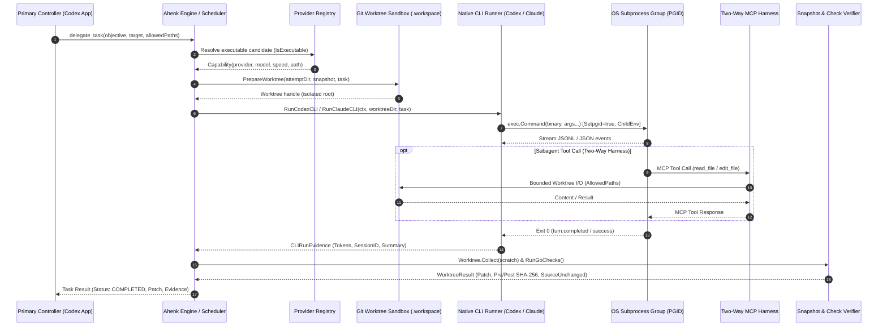

# Epic 5: T3-Grade Multi-Provider Execution Engine & Native CLI Runners

**Epic Identifier:** `EPIC-EXECENGINE-05`  
**Parent Initiative:** Autonomous Subagent Execution & Harness Fidelity  
**Status:** Approved Specification  
**Lead Architect:** Winston (System Architect) & John (Product Manager)  
**Target Milestone:** M2B Autonomous Harness & Multi-Provider Execution Engine  
**Date:** November 13, 2026  

---

## 1. Epic Goal & Value Proposition

Transform Ahenk MCP from a routing scheduler into a high-fidelity **Autonomous Subagent Execution Harness** capable of directly spawning, supervising, communicating with, and collecting results from native AI CLI runners (**OpenAI Codex CLI**, **Anthropic Claude CLI**, **Google Antigravity CLI**, and **OpenCode CLI**).

By implementing robust process group isolation (`Setpgid: true`), streaming JSON-RPC / JSONL event decoders, dynamic capability registration, two-way MCP tool serving within isolated Git worktrees, and cryptographic pre/post SHA-256 diff verification, Ahenk MCP reaches parity with T3 Code's native harness architecture. This ensures that subagents operate with strict sandbox isolation, produce audited git diff patches, and never leave orphaned processes or compromised repositories.



---

## 2. Stories Breakdown

### Story 5.1: Codex CLI Subprocess Runner (`RunCodexCLI`)

**User Story:**
> **As an** Ahenk MCP Execution Engine,  
> **I want to** execute the native `codex exec` binary in a headless, non-interactive streaming mode with isolated process group semantics,  
> **So that** subagent coding tasks assigned to OpenAI Codex models run securely, stream real-time JSONL events, record token utilization, and cleanly terminate upon cancellation.

**Acceptance Criteria (Gherkin):**

```gherkin
Feature: Codex CLI Subprocess Runner

  Scenario: Successful execution of bounded task via codex exec
    Given an approved capability for provider "codex" and model "gpt-5-sol"
    And a target worktree directory "/private/tmp/ahenk/attempt-123/.workspace"
    And a scoped task with objective "Refactor network parser" and effort "medium"
    When RunCodexCLI is invoked with the task and worktree parameters
    Then the subprocess is launched with args:
      | exec | --json | --ephemeral | --skip-git-repo-check | --full-auto | --sandbox | workspace-write | -m | gpt-5-sol | -c | model_reasoning_effort="medium" | -c | mcp_servers.ahenk.enabled=false | -C | /private/tmp/ahenk/attempt-123/.workspace |
    And the subprocess is assigned to its own process group (Setpgid: true)
    And the streaming stdout parser decodes "thread.started", "item.completed", and "turn.completed"
    And the returned FixtureInput contains non-empty Summary and valid CLIRunEvidence with InputTokens and OutputTokens > 0.

  Scenario: Headless read-only analysis task
    Given a task with mode "read_only" or "analysis"
    When RunCodexCLI formats the command arguments
    Then the arguments contain "--sandbox" "read-only"
    And the arguments omit "--full-auto".

  Scenario: Codex rate limit error detection (HTTP 429)
    Given a running codex CLI process that outputs a "turn.failed" event with "usage_limit_reached (429)"
    When ParseCodexJSONL parses the event stream
    Then an error with code "RATE_LIMIT" is returned
    And the execution engine triggers circuit breaker tripping for provider "codex".

  Scenario: Subprocess timeout and graceful process group termination
    Given a running codex CLI process group with PGID 9876
    When the task context deadline expires
    Then a SIGTERM signal is broadcast to process group -9876
    And if the process does not terminate within 3 seconds, a SIGKILL signal is sent to -9876
    And no orphaned child processes remain running on the system.
```

**Technical Specifications:**
- **Files Modified/Created:**
  - `internal/providers/codex_cli.go`
  - `internal/providers/codex_cli_test.go`
- **Function Signatures:**
  ```go
  // RunCodexCLI executes codex exec against the specified worktree with streaming JSONL decoding.
  func RunCodexCLI(ctx context.Context, dir string, cfg model.ProviderConfig, t model.Task, files map[string]string) (execution.FixtureInput, error)

  // superviseCodexCLI wraps execution with OS worker lease management and timeout controls.
  func superviseCodexCLI(ctx context.Context, dir string, req codexCLIRequest) (execution.FixtureInput, error)
  ```
- **Process Attributes & Environment:**
  - `cmd.SysProcAttr = &syscall.SysProcAttr{Setpgid: true}`
  - Environment filtered using `codexEnv(os.Environ(), tempDir, depth, maxDepth)` to ensure zero API key leakage and avoid recursion.
  - Stdin supplied with prompt text via pipe; stdout ingested via buffered reader (`1MB` scan buffer).
- **Evidence Model:** Populate `execution.FixtureInput.Codex` with `model.CLIRunEvidence`:
  - `StartupVerified: true` (upon `thread.started`)
  - `TerminalVerified: true` (upon `turn.completed`)
  - `SessionSHA256`: Thread ID digest
  - `InputTokens`, `OutputTokens`

**Testing Scenarios:**
- Unit test: `TestRunCodexCLI_ArgsFormat` validating flag ordering, sandbox selection, and effort injection.
- Mock CLI test: `TestRunCodexCLI_StreamingParser` streaming synthetic JSONL fixture to assert evidence generation.
- Process group test: `TestRunCodexCLI_CancellationKillsGroup` asserting no zombie child processes after context cancel.

---

### Story 5.2: Claude CLI Subprocess Runner (`RunClaudeCLI`)

**User Story:**
> **As an** Ahenk MCP Execution Engine,  
> **I want to** execute the native `claude` CLI binary in non-interactive headless mode with fine-grained tool whitelisting and JSON output collection,  
> **So that** tasks routed to Anthropic Claude models execute within isolated worktrees, adhere to permission boundaries, and report structured token and summary evidence.

**Acceptance Criteria (Gherkin):**

```gherkin
Feature: Claude CLI Subprocess Runner

  Scenario: Headless code modification task execution
    Given an approved capability for provider "claude" and model "claude-3-7-sonnet"
    And a scoped patch task with write permissions
    When RunClaudeCLI is invoked with prompt and worktree directory
    Then the subprocess is launched with:
      | -p | <task_prompt> | --output-format | json | --model | claude-3-7-sonnet | --permission-mode | acceptEdits | --allowedTools | Read,Edit,Write,Grep,Glob | --disallowedTools | Bash,WebFetch,WebSearch,NotebookEdit | --strict-mcp-config | --mcp-config | {"mcpServers":{}} |
    And working directory (Cwd) is set to the isolated worktree directory
    And stdout is decoded via ParseClaudeJSON into CLIRunEvidence with valid token metrics and summary text.

  Scenario: Read-only analysis and code review task
    Given a task with mode "review" or "analysis"
    When RunClaudeCLI formats the command arguments
    Then the arguments specify:
      | --permission-mode | plan | --tools | Read,Grep,Glob |
    And file-modifying tools "Edit" and "Write" are excluded from allowed tools.

  Scenario: Claude rate limit or overload error handling
    Given Claude CLI output containing "rate_limit_error" or "overloaded_error" in JSON result
    When ParseClaudeJSON parses the error payload
    Then an error with code "RATE_LIMIT" is returned
    And the circuit breaker for provider "claude" is updated with a cooldown window.

  Scenario: Authentication failure handling
    Given Claude CLI output containing "credit balance too low" or "authentication_error"
    When ParseClaudeJSON decodes the payload
    Then an error with code "AUTH_REQUIRED" is returned
    And capability status is transitioned to "unverified".
```

**Technical Specifications:**
- **Files Modified/Created:**
  - `internal/providers/claude_cli.go`
  - `internal/providers/claude_cli_test.go`
- **Function Signatures:**
  ```go
  // RunClaudeCLI executes claude CLI in the worktree directory with strict tool permissions.
  func RunClaudeCLI(ctx context.Context, dir string, cfg model.ProviderConfig, t model.Task, files map[string]string) (execution.FixtureInput, error)

  // superviseClaudeCLI executes claude CLI under supervisor control with lease isolation.
  func superviseClaudeCLI(ctx context.Context, dir string, req claudeCLIRequest) (execution.FixtureInput, error)
  ```
- **Security Invariants:**
  - `--strict-mcp-config` and `--mcp-config {"mcpServers":{}}` prevent subagent from discovering external MCP servers.
  - `--disallowedTools Bash,WebFetch,WebSearch,NotebookEdit` prevents arbitrary command execution or unauthorized network calls.
- **Evidence Model:** Populate `execution.FixtureInput.Claude` with `model.CLIRunEvidence`.

**Testing Scenarios:**
- Unit test: `TestRunClaudeCLI_ArgsAndToolPermissions` verifying read-only vs edit mode flags.
- Unit test: `TestRunClaudeCLI_JSONParser_SuccessAndErrors` with recorded Claude JSON outputs.
- Integration test with mock Claude executable verifying stdin/stdout handling and exit code propagation.

---

### Story 5.3: Provider Registry Dynamic Registration & Capability Admission

**User Story:**
> **As an** Ahenk MCP Dispatcher,  
> **I want to** dynamically register `codex` and `claude` CLI capabilities during Registry initialization and wire their execution branches in `Registry.Run`,  
> **So that** `Engine.IsExecutable("codex")` and `Engine.IsExecutable("claude")` return true when valid CLI binaries exist, allowing the dynamic routing engine to select them.

**Acceptance Criteria (Gherkin):**

```gherkin
Feature: Provider Registry Capability Admission and Dispatch

  Scenario: Initialize registry with available Codex and Claude CLI binaries
    Given a configuration specifying provider paths:
      | ID | Path | Model | Speed |
      | codex | /usr/local/bin/codex | gpt-5-sol | fast |
      | claude | /usr/local/bin/claude | claude-3-7-sonnet | fast |
    And the binaries exist, are regular executables, and match their canonical paths
    When providers.New(config) initializes the Registry
    Then Registry.Candidates contains entries for "codex" and "claude"
    And candidate status is set to "available" with computed SHA-256 fingerprints
    And Engine.IsExecutable("codex") returns true
    And Engine.IsExecutable("claude") returns true.

  Scenario: Binary unavailable or modified
    Given a configuration for provider "codex" pointing to a non-existent path or changed SHA-256
    When providers.New(config) inspects the binary
    Then candidate status is set to "unverified" with Reason "BINARY_UNAVAILABLE" or "BINARY_CHANGED"
    And Engine.IsExecutable("codex") returns false.

  Scenario: Dispatch task to Codex CLI runner in Registry.Run
    Given a registered "codex" capability with status "available"
    And a scoped coding task with target "codex/gpt-5-sol"
    When Registry.Run is invoked
    Then execution branches to RunCodexCLI
    And the resulting FixtureInput contains non-empty Codex evidence and patch summary.

  Scenario: Dispatch task to Claude CLI runner in Registry.Run
    Given a registered "claude" capability with status "available"
    And a scoped coding task with target "claude/claude-3-7-sonnet"
    When Registry.Run is invoked
    Then execution branches to RunClaudeCLI
    And the resulting FixtureInput contains non-empty Claude evidence and summary.
```

**Technical Specifications:**
- **Files Modified:**
  - `internal/providers/providers.go`
  - `internal/providers/providers_test.go`
  - `internal/orchestration/engine.go`
- **Registry Initialization Changes:**
  - In `providers.New(c model.Config)`, initialize default candidate stubs:
    ```go
    {Provider: "codex", Status: "unverified", Reason: "CLI_BINARY_INSPECTION_REQUIRED", Mode: "cli"},
    {Provider: "claude", Status: "unverified", Reason: "CLI_BINARY_INSPECTION_REQUIRED", Mode: "cli"},
    ```
  - In configuration loop, inspect `p.Path` via `Fingerprint(p.Path)` and promote `Status = "available"` if binary passes security checks.
- **Dispatch Integration:**
  - In `Registry.Run(ctx, dir, c, t, contextFiles, handoffs)`:
    ```go
    if c.Provider == "codex" && c.Status == "available" {
        return RunCodexCLI(ctx, dir, r.codexConfig, t, contextFiles)
    }
    if c.Provider == "claude" && c.Status == "available" {
        return RunClaudeCLI(ctx, dir, r.claudeConfig, t, contextFiles)
    }
    ```
  - In `Registry.RunTrustedLocal(ctx, dir, work, c, t, writePaths)`:
    Support `codex` and `claude` runners executing within the isolated worktree directory `work`.

**Testing Scenarios:**
- Unit test: `TestRegistry_CodexAndClaudeAdmission` verifying `Registry.Candidates` inspection and `IsExecutable`.
- Unit test: `TestRegistry_Run_DispatchBranches` verifying correct routing to Codex and Claude runners.

---

### Story 5.4: Two-Way MCP Harness & Subagent Tool Invocation Protocol

**User Story:**
> **As an** autonomous subagent running in a private worktree,  
> **I want to** interact with Ahenk MCP via an isolated two-way tool harness,  
> **So that** I can execute necessary bounded file reads, edits, and status checks without escaping the sandbox or accessing unauthorized host resources.

**Acceptance Criteria (Gherkin):**

```gherkin
Feature: Two-Way MCP Harness Protocol

  Scenario: Subagent invokes read_file within worktree boundary
    Given a subagent executing inside worktree "/private/tmp/ahenk/attempt-123/.workspace"
    And the task AllowedPaths includes "pkg/parser/lexer.go"
    When the subagent sends an MCP tool call "read_file" with path "pkg/parser/lexer.go"
    Then the two-way harness returns the file contents
    And no access outside the worktree root is permitted.

  Scenario: Subagent attempts path traversal outside worktree
    Given a running subagent
    When the subagent invokes "read_file" with path "../../etc/passwd" or "/etc/shadow"
    Then the harness rejects the tool call with error "POLICY_DENIED: path outside sandbox boundary"
    And the attempted violation is logged to the security audit trail.

  Scenario: Subagent invokes finish tool to signal task completion
    Given a subagent that has completed code changes
    When the subagent sends tool call "finish" with summary "Refactoring completed successfully"
    Then the two-way harness records the summary
    And terminates the subagent execution cleanly with exit status 0.

  Scenario: Recursion guard prevents nested subagent spawns
    Given a child subagent running with depth = 1
    When the subagent attempts to invoke "delegate_task" or spawn another agent
    Then the harness denies the request with "RECURSION_DEPTH_EXCEEDED"
    And prevents nested subprocess forks.
```

**Technical Specifications:**
- **Files Modified/Created:**
  - `internal/ipc/harness.go`
  - `internal/ipc/harness_test.go`
  - `internal/execution/worktree.go`
- **Harness Architecture:**
  - Local stdio / Unix domain socket server spawned inside the attempt directory (`.workspace/.harness.sock`).
  - Restricted tool set exposed to child:
    - `read_file(path string)`: validates `model.InScope(path, t.AllowedPaths)`.
    - `edit_file(path string, diff string)`: applies edits strictly to files in `writePaths`.
    - `finish(summary string)`: finalizes work and provides commit summary.
  - Environment variable `AHENK_HARNESS_SOCKET` passed to child process.

**Testing Scenarios:**
- Unit test: `TestTwoWayHarness_ToolFencing` testing allowed vs denied file paths.
- Unit test: `TestTwoWayHarness_FinishSignal` verifying graceful termination on finish tool call.
- Recursion test: `TestTwoWayHarness_RecursionGuard` confirming nested delegation is blocked.

---

### Story 5.5: Execution Policy, Writer Isolation & End-to-End Live Subagent Verification

**User Story:**
> **As an** Ahenk MCP System Verifier,  
> **I want to** enforce strict writer isolation, compute pre/post SHA-256 file hashes, generate unified diffs, and execute deterministic Go checks,  
> **So that** code changes produced by autonomous subagents are cryptographically verified, deterministic, and safe to merge.

**Acceptance Criteria (Gherkin):**

```gherkin
Feature: Writer Isolation and Verification Pipeline

  Scenario: Verification of valid modifications within AllowedPaths
    Given a task with AllowedPaths ["internal/parser/ast.go"]
    And a pre-execution worktree snapshot with digest "d8f1a23..."
    When a subagent edits "internal/parser/ast.go" and completes execution
    Then Worktree.Collect computes pre-image and post-image SHA-256 hashes
    And verifies that all files outside AllowedPaths are bit-for-bit unchanged (SourceUnchanged: true)
    And generates a unified git patch artifact.

  Scenario: Subagent modifies unpermitted file
    Given a task with AllowedPaths ["internal/parser/ast.go"]
    When the subagent creates or modifies "internal/auth/tokens.go"
    Then Worktree.Collect detects unpermitted file modification
    Then the task fails with "POLICY_DENIED: native edit changed a protected file"
    And all changes are quarantined and discarded.

  Scenario: Automated Go check execution on modified worktree
    Given a task with acceptance criteria check "TestASTParser"
    And a successful code modification by a subagent
    When RunGoChecks executes the registered test against the worktree
    Then the test executes within the isolated worktree directory
    And if exit code is 0, CheckEvidence is recorded as "PASSED"
    And the final unified patch is persisted to the audit store.

  Scenario: End-to-end live subagent verification workflow
    Given a delegate_task request with target "codex/gpt-5-sol" and registered check
    When the complete pipeline executes:
      | Route Selection -> Worktree Prep -> Native CLI Exec -> Tool Harness -> Diff Collection -> Go Check |
    Then the job status transitions: SUBMITTED -> RUNNING -> COMPLETED
    And the controller receives verified diff output, token evidence, and check results.
```

**Technical Specifications:**
- **Files Modified:**
  - `internal/execution/worktree.go`
  - `internal/orchestration/implementation.go`
  - `internal/orchestration/implementation_test.go`
- **Verification Invariants:**
  - `SourceFingerprint`: SHA-256 of common git objects before execution.
  - `SourceUnchanged`: must evaluate to `true` verifying that the host working tree was untouched.
  - `Preimages` and `Postimages`: map of `path -> SHA256` for all touched files; every touched path must satisfy `model.InScope(path, t.AllowedPaths)`.
  - Deterministic Go checks: `execution.RunGoChecks(ctx, dir, w.Dir, tool, checks)`.

**Testing Scenarios:**
- Unit test: `TestWriterIsolation_PathFencing` verifying rejection of unauthorized file edits.
- Unit test: `TestWorktree_DiffGeneration` asserting valid unified git patch format.
- Integration test: `TestEndToEnd_SubagentVerificationPipeline` executing full lifecycle from worktree prep to Go check completion.

---

## 3. Implementation Plan & Deliverables Summary

| Phase | Milestone | Key Deliverables |
| :--- | :--- | :--- |
| **Phase 1** | CLI Runner Engines | Story 5.1 (`RunCodexCLI`) & Story 5.2 (`RunClaudeCLI`) with process group isolation. |
| **Phase 2** | Dynamic Admission & Dispatch | Story 5.3 (`Registry.Candidates` admission, `IsExecutable`, `Registry.Run` dispatch). |
| **Phase 3** | Two-Way Harness | Story 5.4 (In-worktree MCP loopback harness, bounded tool invocation). |
| **Phase 4** | Verification & Integration | Story 5.5 (Writer isolation, pre/post SHA-256 checks, end-to-end integration test). |
