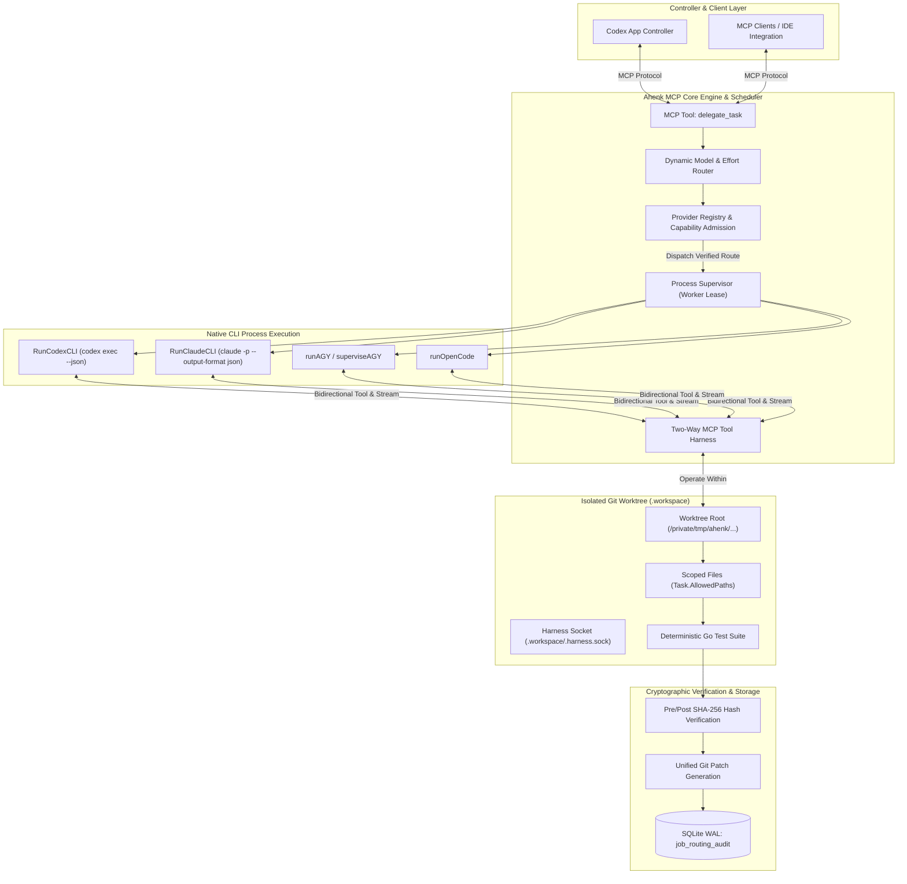
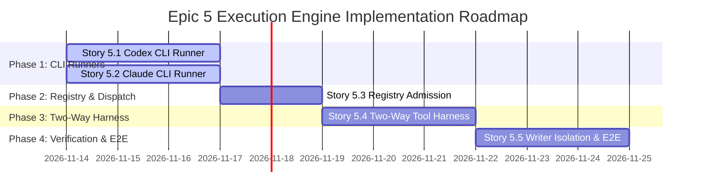

# Ahenk MCP: T3-Grade Multi-Provider Execution Engine & Native CLI Runners
## Consolidated Epics & Stories Master Specification

**Document Identifier:** `AHENK-BMAD-MASTER-EXECENGINE-2026-11`  
**Version:** `1.0.0-PROD`  
**Status:** Approved Specification  
**Architecture Source:** `AHENK-DOC-EXECENGINE-2026-11`  
**Target Milestone:** M2B Autonomous Harness & Multi-Provider Execution Engine  
**Owner & Authors:** Ahenk Subagent BMAD Team (John - PM, Winston - Architect, Amelia - Dev, Sally - UX, Mary - Analyst)  
**Date:** November 13, 2026  

---

## 1. Overview & Architectural Blueprint

This document specifies the consolidated master engineering specification for **Epic 5: T3-Grade Multi-Provider Execution Engine & Native CLI Runners** in Ahenk MCP.

Ahenk MCP functions as a local autonomous task orchestrator and scheduler for AI developer agents, with **Codex App serving as the primary controller**. The system delegates bounded programming tasks to independent providers (**OpenAI Codex Pro**, **Anthropic Claude CLI**, **Google Antigravity AI Pro**, and **OpenCode Free Tier**). 

While dynamic routing, CodexBar telemetry observation, and 10-tier fallback matrices have been successfully implemented, this initiative addresses the physical execution engine layer:
1. Native subprocess runners for **Codex CLI** (`RunCodexCLI`, `codex exec`) and **Claude CLI** (`RunClaudeCLI`, `claude`).
2. Dynamic provider capability admission in `Registry.Candidates`, enabling `Engine.IsExecutable("codex")` and `Engine.IsExecutable("claude")` to admit and execute live tasks.
3. Execution dispatch branching within `Registry.Run` and `Registry.RunTrustedLocal`.
4. Bidirectional in-worktree MCP harness tool protocol (`.workspace/.harness.sock`), allowing child subagents to execute authorized local tool calls (`read_file`, `edit_file`, `finish`) while enforcing strict isolation and recursion guards.
5. Strict writer isolation policy, SHA-256 pre/post snapshot hashing, unified diff collection, and deterministic Go check verification.



---

## 2. Requirements Inventory

### 2.1. Functional Requirements (FR)

- **FR-13 (Native Codex CLI Subprocess Runner):** Execute `codex exec` in non-interactive streaming mode (`--json`, `--ephemeral`, `--skip-git-repo-check`), formatting model and reasoning effort parameters, capturing JSONL event frames, and enforcing process group lifecycle management.
- **FR-14 (Native Claude CLI Subprocess Runner):** Execute `claude` in headless non-interactive mode (`-p`, `--output-format json`), enforcing strict MCP isolation (`--strict-mcp-config`), fine-grained tool whitelisting (`Read,Edit,Write,Grep,Glob`), and structured output parsing.
- **FR-15 (Dynamic Provider Registry Admission):** Add `codex` and `claude` CLI capability candidates into `Registry.Candidates` during `New(c model.Config)`, compute SHA-256 binary fingerprints, validate executable paths, and ensure `Engine.IsExecutable(provider)` reflects live availability.
- **FR-16 (Registry Execution Dispatch Integration):** Wire `Registry.Run` and `Registry.RunTrustedLocal` dispatch branches for `"codex"` and `"claude"`, passing task parameters, worktree paths, context files, and execution budgets down to the respective native CLI runners.
- **FR-17 (Two-Way MCP Harness Protocol):** Provide an in-worktree MCP loopback / stdio harness allowing child subagents to execute authorized local tool calls (`read_file`, `edit_file`, `finish`, `check`) while preventing recursion and unauthorized host system access.
- **FR-18 (Process Group Isolation & Clean Termination):** Isolate all spawned CLI runner subprocesses in independent process groups (`Setpgid: true`), preventing orphaned child processes on cancellation, timeout, or controller disconnect via graceful SIGTERM followed by SIGKILL escalation.
- **FR-19 (Worktree Writer Isolation & Path Fencing):** Enforce that subagents operating in private worktrees can write only to files explicitly listed in `Task.AllowedPaths`, validating that external files remain immutable (`SourceUnchanged: true`).
- **FR-20 (Pre/Post SHA-256 Digest & Check Verification):** Compute SHA-256 pre-images and post-images for all modified files, generate clean unified git diffs, execute registered deterministic Go tests, and ensure full audit compliance.

### 2.2. Non-Functional Requirements (NFR)

- **NFR-06 (Subprocess Startup Overhead):** Native CLI runner execution overhead (fork/exec, argument construction, environment sanitization) must not exceed $50\text{ ms}$ before child process handoff.
- **NFR-07 (Orphan Process Zero-Tolerance):** 100% of subagent child processes and descendants must terminate within $5\text{ seconds}$ of context cancellation or task timeout. Zero orphaned processes allowed on the host.
- **NFR-08 (Stream Ingestion Throughput):** Streaming JSONL/JSON parsers must sustain $\ge 500\text{ events/sec}$ or $5\text{ MB/sec}$ of log stream without dropping frames or causing unbounded memory allocation.
- **NFR-09 (Memory & Artifact Fencing):** Output log buffers must be bounded by `MaxArtifact` ($10\text{ MB}$), gracefully truncating non-critical terminal logs while preserving critical error payloads and diff evidence.
- **NFR-10 (Zero Credential Leakage):** Subprocess environments must be scrubbed of API keys, tokens, and parent session IDs (`ChildEnv`), exposing only necessary sandbox variables (`TMPDIR`, `PATH`, sanitized `HOME`).

---

## 3. Epics and Stories Specification

### Story 5.1: Codex CLI Subprocess Runner (`RunCodexCLI`)

**User Story:**
> **As an** Ahenk MCP Execution Engine,  
> **I want to** execute the native `codex exec` binary in a headless, non-interactive streaming mode with isolated process group semantics,  
> **So that** subagent coding tasks assigned to OpenAI Codex models run securely, stream real-time JSONL events, record token utilization, and cleanly terminate upon cancellation.

**Acceptance Criteria (Gherkin):**

```gherkin
Feature: Codex CLI Subprocess Runner

  Scenario: Successful execution of bounded task via codex exec
    Given an approved capability for provider "codex" and model "gpt-5-sol"
    And a target worktree directory "/private/tmp/ahenk/attempt-123/.workspace"
    And a scoped task with objective "Refactor network parser" and effort "medium"
    When RunCodexCLI is invoked with the task and worktree parameters
    Then the subprocess is launched with args:
      | exec | --json | --ephemeral | --skip-git-repo-check | --full-auto | --sandbox | workspace-write | -m | gpt-5-sol | -c | model_reasoning_effort="medium" | -c | mcp_servers.ahenk.enabled=false | -C | /private/tmp/ahenk/attempt-123/.workspace |
    And the subprocess is assigned to its own process group (Setpgid: true)
    And the streaming stdout parser decodes "thread.started", "item.completed", and "turn.completed"
    And the returned FixtureInput contains non-empty Summary and valid CLIRunEvidence with InputTokens and OutputTokens > 0.

  Scenario: Headless read-only analysis task
    Given a task with mode "read_only" or "analysis"
    When RunCodexCLI formats the command arguments
    Then the arguments contain "--sandbox" "read-only"
    And the arguments omit "--full-auto".

  Scenario: Codex rate limit error detection (HTTP 429)
    Given a running codex CLI process that outputs a "turn.failed" event with "usage_limit_reached (429)"
    When ParseCodexJSONL parses the event stream
    Then an error with code "RATE_LIMIT" is returned
    And the execution engine triggers circuit breaker tripping for provider "codex".

  Scenario: Subprocess timeout and graceful process group termination
    Given a running codex CLI process group with PGID 9876
    When the task context deadline expires
    Then a SIGTERM signal is broadcast to process group -9876
    And if the process does not terminate within 3 seconds, a SIGKILL signal is sent to -9876
    And no orphaned child processes remain running on the system.
```

**Technical Specifications:**
- **Files Modified/Created:**
  - `internal/providers/codex_cli.go`
  - `internal/providers/codex_cli_test.go`
- **Function Signatures:**
  ```go
  func RunCodexCLI(ctx context.Context, dir string, cfg model.ProviderConfig, t model.Task, files map[string]string) (execution.FixtureInput, error)
  func superviseCodexCLI(ctx context.Context, dir string, req codexCLIRequest) (execution.FixtureInput, error)
  ```
- **Process Group & Signal Isolation:**
  - `cmd.SysProcAttr = &syscall.SysProcAttr{Setpgid: true}` ensures child does not receive parent signals directly.
  - On cancellation, `syscall.Kill(-pgid, syscall.SIGTERM)` followed by `syscall.Kill(-pgid, syscall.SIGKILL)` after timeout.

---

### Story 5.2: Claude CLI Subprocess Runner (`RunClaudeCLI`)

**User Story:**
> **As an** Ahenk MCP Execution Engine,  
> **I want to** execute the native `claude` CLI binary in non-interactive headless mode with fine-grained tool whitelisting and JSON output collection,  
> **So that** tasks routed to Anthropic Claude models execute within isolated worktrees, adhere to permission boundaries, and report structured token and summary evidence.

**Acceptance Criteria (Gherkin):**

```gherkin
Feature: Claude CLI Subprocess Runner

  Scenario: Headless code modification task execution
    Given an approved capability for provider "claude" and model "claude-3-7-sonnet"
    And a scoped patch task with write permissions
    When RunClaudeCLI is invoked with prompt and worktree directory
    Then the subprocess is launched with:
      | -p | <task_prompt> | --output-format | json | --model | claude-3-7-sonnet | --permission-mode | acceptEdits | --allowedTools | Read,Edit,Write,Grep,Glob | --disallowedTools | Bash,WebFetch,WebSearch,NotebookEdit | --strict-mcp-config | --mcp-config | {"mcpServers":{}} |
    And working directory (Cwd) is set to the isolated worktree directory
    And stdout is decoded via ParseClaudeJSON into CLIRunEvidence with valid token metrics and summary text.

  Scenario: Read-only analysis and code review task
    Given a task with mode "review" or "analysis"
    When RunClaudeCLI formats the command arguments
    Then the arguments specify:
      | --permission-mode | plan | --tools | Read,Grep,Glob |
    And file-modifying tools "Edit" and "Write" are excluded from allowed tools.

  Scenario: Claude rate limit or overload error handling
    Given Claude CLI output containing "rate_limit_error" or "overloaded_error" in JSON result
    When ParseClaudeJSON parses the error payload
    Then an error with code "RATE_LIMIT" is returned
    And the circuit breaker for provider "claude" is updated with a cooldown window.
```

**Technical Specifications:**
- **Files Modified/Created:**
  - `internal/providers/claude_cli.go`
  - `internal/providers/claude_cli_test.go`
- **Function Signatures:**
  ```go
  func RunClaudeCLI(ctx context.Context, dir string, cfg model.ProviderConfig, t model.Task, files map[string]string) (execution.FixtureInput, error)
  func superviseClaudeCLI(ctx context.Context, dir string, req claudeCLIRequest) (execution.FixtureInput, error)
  ```
- **Permission Fencing:**
  - Enforce `--permission-mode acceptEdits` with tool whitelist to disallow bash escapes and network exfiltration.

---

### Story 5.3: Provider Registry Dynamic Registration & Capability Admission

**User Story:**
> **As an** Ahenk MCP Dispatcher,  
> **I want to** dynamically register `codex` and `claude` CLI capabilities during Registry initialization and wire their execution branches in `Registry.Run`,  
> **So that** `Engine.IsExecutable("codex")` and `Engine.IsExecutable("claude")` return true when valid CLI binaries exist, allowing the dynamic routing engine to select them.

**Acceptance Criteria (Gherkin):**

```gherkin
Feature: Provider Registry Capability Admission and Dispatch

  Scenario: Initialize registry with available Codex and Claude CLI binaries
    Given a configuration specifying provider paths:
      | ID | Path | Model | Speed |
      | codex | /usr/local/bin/codex | gpt-5-sol | fast |
      | claude | /usr/local/bin/claude | claude-3-7-sonnet | fast |
    And the binaries exist, are regular executables, and match their canonical paths
    When providers.New(config) initializes the Registry
    Then Registry.Candidates contains entries for "codex" and "claude"
    And candidate status is set to "available" with computed SHA-256 fingerprints
    And Engine.IsExecutable("codex") returns true
    And Engine.IsExecutable("claude") returns true.

  Scenario: Dispatch task to Codex CLI runner in Registry.Run
    Given a registered "codex" capability with status "available"
    And a scoped coding task with target "codex/gpt-5-sol"
    When Registry.Run is invoked
    Then execution branches to RunCodexCLI
    And the resulting FixtureInput contains non-empty Codex evidence and patch summary.

  Scenario: Dispatch task to Claude CLI runner in Registry.Run
    Given a registered "claude" capability with status "available"
    And a scoped coding task with target "claude/claude-3-7-sonnet"
    When Registry.Run is invoked
    Then execution branches to RunClaudeCLI
    And the resulting FixtureInput contains non-empty Claude evidence and summary.
```

**Technical Specifications:**
- **Files Modified:**
  - `internal/providers/providers.go`
  - `internal/orchestration/engine.go`
- **Candidate Registry Registration:**
  - Add `codex` and `claude` to base candidate list in `providers.New(c)`.
  - Validate canonical executable path and compute SHA-256 binary fingerprint.
- **Dispatch Routing:**
  - Wire `Registry.Run` and `Registry.RunTrustedLocal` cases for `"codex"` and `"claude"`.

---

### Story 5.4: Two-Way MCP Harness & Subagent Tool Invocation Protocol

**User Story:**
> **As an** autonomous subagent running in a private worktree,  
> **I want to** interact with Ahenk MCP via an isolated two-way tool harness,  
> **So that** I can execute necessary bounded file reads, edits, and status checks without escaping the sandbox or accessing unauthorized host resources.

**Acceptance Criteria (Gherkin):**

```gherkin
Feature: Two-Way MCP Harness Protocol

  Scenario: Subagent invokes read_file within worktree boundary
    Given a subagent executing inside worktree "/private/tmp/ahenk/attempt-123/.workspace"
    And the task AllowedPaths includes "pkg/parser/lexer.go"
    When the subagent sends an MCP tool call "read_file" with path "pkg/parser/lexer.go"
    Then the two-way harness returns the file contents
    And no access outside the worktree root is permitted.

  Scenario: Subagent attempts path traversal outside worktree
    Given a running subagent
    When the subagent invokes "read_file" with path "../../etc/passwd" or "/etc/shadow"
    Then the harness rejects the tool call with error "POLICY_DENIED: path outside sandbox boundary"
    And the attempted violation is logged to the security audit trail.

  Scenario: Subagent invokes finish tool to signal task completion
    Given a subagent that has completed code changes
    When the subagent sends tool call "finish" with summary "Refactoring completed successfully"
    Then the two-way harness records the summary
    And terminates the subagent execution cleanly with exit status 0.
```

**Technical Specifications:**
- **Files Modified/Created:**
  - `internal/ipc/harness.go`
  - `internal/ipc/harness_test.go`
  - `internal/execution/worktree.go`
- **IPC Protocol:** Unix domain socket or bidirectional stdio channel bound to the worktree attempt directory.
- **Security Fencing:** Strict path validation ensuring all tool arguments resolve inside `.workspace` and intersect `Task.AllowedPaths`.

---

### Story 5.5: Execution Policy, Writer Isolation & End-to-End Live Subagent Verification

**User Story:**
> **As an** Ahenk MCP System Verifier,  
> **I want to** enforce strict writer isolation, compute pre/post SHA-256 file hashes, generate unified diffs, and execute deterministic Go checks,  
> **So that** code changes produced by autonomous subagents are cryptographically verified, deterministic, and safe to merge.

**Acceptance Criteria (Gherkin):**

```gherkin
Feature: Writer Isolation and Verification Pipeline

  Scenario: Verification of valid modifications within AllowedPaths
    Given a task with AllowedPaths ["internal/parser/ast.go"]
    And a pre-execution worktree snapshot with digest "d8f1a23..."
    When a subagent edits "internal/parser/ast.go" and completes execution
    Then Worktree.Collect computes pre-image and post-image SHA-256 hashes
    And verifies that all files outside AllowedPaths are bit-for-bit unchanged (SourceUnchanged: true)
    And generates a unified git patch artifact.

  Scenario: Subagent modifies unpermitted file
    Given a task with AllowedPaths ["internal/parser/ast.go"]
    When the subagent creates or modifies "internal/auth/tokens.go"
    Then Worktree.Collect detects unpermitted file modification
    Then the task fails with "POLICY_DENIED: native edit changed a protected file"
    And all changes are quarantined and discarded.

  Scenario: Automated Go check execution on modified worktree
    Given a task with acceptance criteria check "TestASTParser"
    And a successful code modification by a subagent
    When RunGoChecks executes the registered test against the worktree
    Then the test executes within the isolated worktree directory
    And if exit code is 0, CheckEvidence is recorded as "PASSED"
    And the final unified patch is persisted to the audit store.
```

**Technical Specifications:**
- **Files Modified:**
  - `internal/execution/worktree.go`
  - `internal/orchestration/implementation.go`
  - `internal/orchestration/implementation_test.go`
- **Cryptographic Diff Pipeline:**
  - SHA-256 digest computation for pre-image files.
  - Traversal of `.workspace` directory post-execution.
  - Validation that zero files outside `AllowedPaths` were created, modified, or unlinked.
  - Execution of deterministic test checks using `execution.RunGoChecks`.

---

## 4. Architectural Verification and Testing Roadmap



1. **Unit & Synthetic Test Suite:** Run offline tests with synthetic binaries and mock subprocess runners to assert argument escaping, JSONL streaming, token accounting, and PGID signal delivery.
2. **Process Group & Signal Resilience:** Test context deadline expiration and verify with OS process tree inspections that child and grandchild processes are 100% terminated.
3. **Sandbox Path Fencing:** Assert that path traversal attempts (`../../`) and unpermitted file writes trigger `POLICY_DENIED` and prevent dirty state pollution.
4. **End-to-End Orchestration Test:** Verify that `delegate_task` seamlessly routes to Codex and Claude CLI runners, executes tasks inside private Git worktrees, verifies Go test checks, and delivers unified patch artifacts back to the primary controller.
