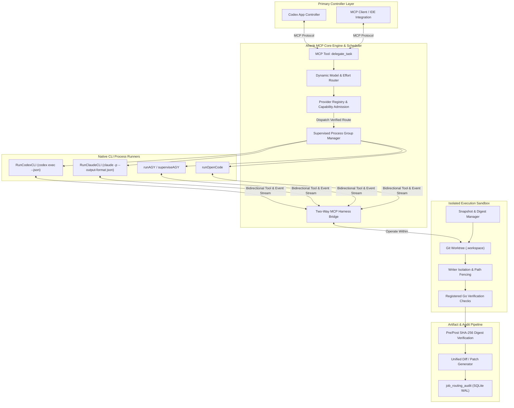
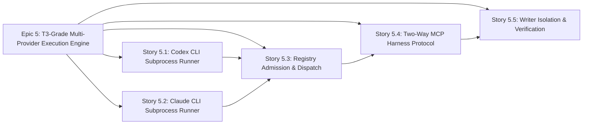

# Ahenk MCP: T3-Grade Multi-Provider Execution Engine & Native CLI Runners
## Epic & Story Master Overview

**Document Identifier:** `AHENK-BMAD-EPIC-EXECENGINE-2026-11`  
**Status:** Approved Specification  
**Architecture Baseline:** `AHENK-DOC-EXECENGINE-2026-11`  
**Target Milestone:** M2B Autonomous Harness & Multi-Provider Execution Engine  
**Owner & Authors:** Ahenk Architecture Subagent & Product Strategy Team (BMAD Methodology)  
**Date:** November 13, 2026  

---

## 1. Executive Summary & Vision

Ahenk MCP was conceived as an intelligent orchestrator and scheduler for autonomous AI developer subagents, with **Codex App serving as the primary controller**. Through Milestone M2A and the dynamic routing initiative (`AHENK-BMAD-EPIC-ROUTING-2026-11`), Ahenk achieved advanced capabilities in multi-provider quota telemetry observation (CodexBar 4-bar pipeline), dynamic reasoning effort resolution (`low`, `medium`, `high`), 10-tier fallback prioritization, and adaptive circuit breakers.

However, recent architectural validation uncovered a critical structural gap between **routing intention** and **physical execution**:
1. **Runner Stubs:** While CLI argument formatters and stream decoders exist (`codexArgs`, `ParseCodexJSONL`, `claudeArgs`, `ParseClaudeJSON`), their active subprocess runners (`RunCodexCLI`, `RunClaudeCLI`) are not implemented.
2. **Registry Admission Void:** `internal/providers/providers.go` initializes candidates strictly for `agy`, `opencode`, and `copilot`. Neither `codex` nor `claude` CLI engines are registered as executable candidates. Consequently, `Engine.IsExecutable("codex")` and `Engine.IsExecutable("claude")` evaluate to `false`, causing the scheduler's dynamic route picker to bypass OpenAI and Anthropic CLI models regardless of quota availability.
3. **Dispatch Disconnect:** `Registry.Run` contains dispatch branches only for `agy` and `opencode`, falling back to static fixtures for any other provider.
4. **Harness Isolation & Two-Way Protocol:** Running a real subagent inside an isolated Git worktree (`internal/execution/worktree.go`) requires bidirectional harness communication—providing the subagent with tightly scoped tools (e.g., read, edit, check) via MCP or stdio while preventing unauthorized escapes, recursion loops, or host environment tampering.
5. **Writer Isolation & Verification:** Subagent file modifications must be strictly confined to declared write paths (`AllowedPaths`), verified against pre-execution snapshot digests, and captured as deterministic patch artifacts with automated Go check verification.

To elevate Ahenk MCP to **"T3-Grade" execution fidelity** (matching the gold-standard isolation, process supervision, and streaming harness quality of T3 Code), this specification defines **Epic 5: T3-Grade Multi-Provider Execution Engine & Native CLI Runners**.

---

## 2. Requirements Inventory

### 2.1. Functional Requirements (FR)

| FR ID | Requirement Name | Description | Target Story |
| :--- | :--- | :--- | :--- |
| **FR-13** | Native Codex CLI Subprocess Runner | Execute `codex exec` in non-interactive streaming mode (`--json`, `--ephemeral`, `--skip-git-repo-check`), formatting model and reasoning effort parameters, capturing JSONL event frames, and enforcing process group lifecycle management. | Story 5.1 |
| **FR-14** | Native Claude CLI Subprocess Runner | Execute `claude` in headless non-interactive mode (`-p`, `--output-format json`), enforcing strict MCP isolation (`--strict-mcp-config`), fine-grained tool whitelisting (`Read,Edit,Write,Grep,Glob`), and structured output parsing. | Story 5.2 |
| **FR-15** | Dynamic Provider Registry Admission | Add `codex` and `claude` CLI capability candidates into `Registry.Candidates` during `New(c model.Config)`, compute SHA-256 binary fingerprints, validate executable paths, and ensure `Engine.IsExecutable(provider)` reflects live availability. | Story 5.3 |
| **FR-16** | Registry Execution Dispatch Integration | Wire `Registry.Run` and `Registry.RunTrustedLocal` dispatch branches for `"codex"` and `"claude"`, passing task parameters, worktree paths, context files, and execution budgets down to the respective native CLI runners. | Story 5.3 |
| **FR-17** | Two-Way MCP Harness Protocol | Provide an in-worktree MCP loopback / stdio harness allowing child subagents to execute authorized local tool calls (`read_file`, `edit_file`, `finish`, `check`) while preventing recursion and unauthorized host system access. | Story 5.4 |
| **FR-18** | Process Group Isolation & Clean Termination | Isolate all spawned CLI runner subprocesses in independent process groups (`Setpgid: true`), preventing orphaned child processes on cancellation, timeout, or controller disconnect via graceful SIGTERM followed by SIGKILL escalation. | Story 5.1, 5.2, 5.4 |
| **FR-19** | Worktree Writer Isolation & Path Fencing | Enforce that subagents operating in private worktrees can write only to files explicitly listed in `Task.AllowedPaths`, validating that external files remain immutable (`SourceUnchanged: true`). | Story 5.5 |
| **FR-20** | Pre/Post SHA-256 Digest & Check Verification | Compute SHA-256 pre-images and post-images for all modified files, generate clean unified git diffs, execute registered deterministic Go tests, and ensure full audit compliance. | Story 5.5 |

### 2.2. Non-Functional Requirements (NFR)

| NFR ID | Category | Requirement Detail |
| :--- | :--- | :--- |
| **NFR-06** | Subprocess Startup Overhead | Native CLI runner execution overhead (fork/exec, argument construction, environment sanitization) must not exceed $50\text{ ms}$ before child process handoff. |
| **NFR-07** | Orphan Process Zero-Tolerance | 100% of subagent child processes and descendants must terminate within $5\text{ seconds}$ of context cancellation or task timeout. Zero orphaned processes allowed on the host. |
| **NFR-08** | Stream Ingestion Throughput | Streaming JSONL/JSON parsers must sustain $\ge 500\text{ events/sec}$ or $5\text{ MB/sec}$ of log stream without dropping frames or causing unbounded memory allocation. |
| **NFR-09** | Memory & Artifact Fencing | Output log buffers must be bounded by `MaxArtifact` ($10\text{ MB}$), gracefully truncating non-critical terminal logs while preserving critical error payloads and diff evidence. |
| **NFR-10** | Zero Credential Leakage | Subprocess environments must be scrubbed of API keys, tokens, and parent session IDs (`ChildEnv`), exposing only necessary sandbox variables (`TMPDIR`, `PATH`, sanitized `HOME`). |

---

## 3. Epic Breakdown Summary

| Story ID | Story Title | Complexity | Primary Components |
| :--- | :--- | :--- | :--- |
| **Story 5.1** | Codex CLI Subprocess Runner (`RunCodexCLI`) | High | `internal/providers/codex_cli.go`, `internal/execution/process.go` |
| **Story 5.2** | Claude CLI Subprocess Runner (`RunClaudeCLI`) | High | `internal/providers/claude_cli.go`, `internal/execution/process.go` |
| **Story 5.3** | Provider Registry Dynamic Admission & Dispatch | Medium | `internal/providers/providers.go`, `internal/orchestration/engine.go` |
| **Story 5.4** | Two-Way MCP Harness & Subagent Tool Protocol | High | `internal/ipc/`, `internal/mcpserver/`, `internal/execution/worktree.go` |
| **Story 5.5** | Writer Isolation Policy & End-to-End Verification | High | `internal/execution/worktree.go`, `internal/orchestration/implementation.go` |

---

## 4. Requirements Traceability Matrix

| Requirement | Description | Story 5.1 | Story 5.2 | Story 5.3 | Story 5.4 | Story 5.5 |
| :--- | :--- | :---: | :---: | :---: | :---: | :---: |
| **FR-13** | Native Codex CLI Runner | **X** | | | | |
| **FR-14** | Native Claude CLI Runner | | **X** | | | |
| **FR-15** | Dynamic Registry Admission | | | **X** | | |
| **FR-16** | Registry Execution Dispatch | | | **X** | | |
| **FR-17** | Two-Way MCP Harness Protocol | | | | **X** | |
| **FR-18** | Process Group Isolation | **X** | **X** | | **X** | |
| **FR-19** | Writer Isolation & Fencing | | | | | **X** |
| **FR-20** | Pre/Post SHA & Verification | | | | | **X** |
| **NFR-06** | Subprocess Startup Overhead | **X** | **X** | | | |
| **NFR-07** | Orphan Process Zero-Tolerance | **X** | **X** | | **X** | |
| **NFR-08** | Stream Ingestion Throughput | **X** | **X** | | | |
| **NFR-09** | Memory & Artifact Fencing | **X** | **X** | | | **X** |
| **NFR-10** | Zero Credential Leakage | **X** | **X** | | **X** | **X** |
