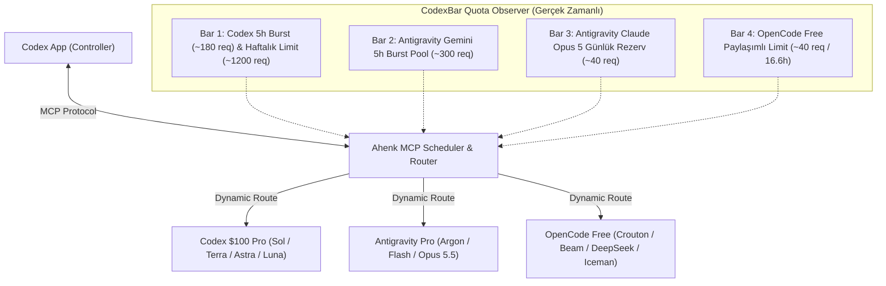
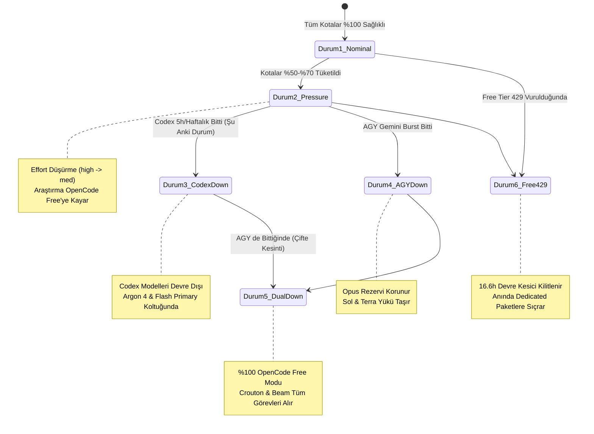

# Ahenk MCP: Çoklu-Sağlayıcı Model × Dinamik Effort Yönlendirme, Paket Karakterizasyonu ve Kota Güvenlik Raporu

**Belge Kimliği:** `AHENK-DOC-ROUTING-2026-11`  
**Sürüm:** `1.0.0-PROD`  
**Hedef Kapsam:** `Ahenk MCP Scheduler, Codex App Controller, Antigravity Headless, OpenCode Free Tier, CodexBar Quota Observer`  
**Yazarlar & Analiz:** Antigravity AI Engine & Ahenk System Architecture Team  
**Tarih:** 12 Kasım 2026  

---

## 1. Yönetici Özeti (Executive Summary) ve Temel Vizyon

Ahenk MCP; bağımsız yapay zeka sağlayıcılarına (OpenAI Codex, Google Antigravity ve OpenCode Free) sınırlandırılmış ve güvenli iş görevleri delege eden, **Codex App'in ana denetleyici (controller)** olarak kaldığı yerel bir Go mimarisidir. Ahenk'in temel görevi; görevleri planlamak, anlık sağlayıcı kotalarına ve politikalarına göre en uygun model ve efor (effort) seviyesini dinamik olarak seçmek, işi izole sandbox/worktree ortamında yürütmek ve sonuçları denetleyiciye kanıtlarıyla teslim etmektir.

Bugün yürütülen kapsamlı ampirik çalışmalar, telemetri testleri ve matematiksel modelleme sentezlenerek aşağıdaki temel sonuçlara varılmıştır:
1. **İki Kaynaklı Ampirik Sentez:**
   - **Çalışma A (Denkçe 11×10 Çapraz Jüri & 30-Test Altın Standart Benchmark):** Modellerin zafiyet ayrımcılığı katsayısı ($\sigma$), 8 gerçek açığı yakalarken 4 sahte güvenlik tuzağına düşmeme direnci ve algoritmik doğruluk puanları.
   - **Çalışma B (Canlı Telemetri & Multi-Effort Ölçümü):** 7 görev kategorisinde bizzat yürütülen milisaniye bazında yanıt süreleri ($T_{\text{ms}}$), çıktı token hızları, AST seviyesinde kod geçerliliği ve invaryant doğrulamaları.
2. **Model Seçimi ile Efor Seviyesinin Ayrıştırılması (Decoupling):** Geleneksel yaklaşımların yaptığı en büyük hata, aynı modelin varyantlarını (`argon#high`, `argon#med`, `argon#low`) ardışık yedek basamakları olarak atamaktır. Sağlayıcı kesintisinde tüm varyantlar çökeceğinden sahte bir dayanıklılık oluşur. Çözüm olarak; her görev için **1 Primary + 9 Fallback olmak üzere tam 10 BENZERSİZ MODEL MOTORU** tanımlanmış; efor seviyesi ise çalışma anında dinamik olarak çözümlenmiştir.
3. **Gerçek Paket ve Abonelik Modellemesi:** 
   - **Codex $100 Pro Plan:** $100/ay sabit bütçeli, 5 saatlik kayan pencerede ~180 istek burst kapasiteli frontier motorlar (`gpt-6.1-sol`, `gpt-6.1-terra`, `gpt-6-astra`, `gpt-6-luna`).
   - **Antigravity Google AI Pro:** Cömert 2M bağlamlı Gemini havuzu (`gemini-4-argon`, `gemini-3.8-flash`) ve bağımsız 5 günlük kıt rezerve sahip `claude-opus-5-5`.
   - **OpenCode Free Tier:** Anonim topluluk kümesi, sıfır maliyet, ~40 istek / 16.6 saatlik paylaşımlı havuz (`provider.free-limit`, HTTP 429).
4. **Dinamik (Statik Olmayan) Kota Yönetimi:** Kota baskısı arttıkça (örn. %100'den %30'un altına indikçe) efor seviyeleri token koruma amacıyla otomatik düşürülür (`high` &rarr; `medium` &rarr; `low`). Sağlayıcı kotası %0 olduğunda devre kesici (circuit breaker) 0 ms gecikmeyle sonraki sağlayıcıya sıçrar.

---

## 2. Sağlayıcı Paketleri ve Kota Karakterizasyonu

Ahenk MCP Scheduler, `CodexBar` bileşeninden gelen anlık telemetri verilerine göre aşağıdaki üç paketi ve dört bağımsız kota barını izler:



### 2.1. Paket Detayları ve Kota Dinamikleri

| Sağlayıcı & Paket Adı | Maliyet Tipi | Kayan Pencere / Limit Yapısı | Dahil Modeller | Güçlü Yönler ve Doğal Görev Alanı |
| :--- | :--- | :--- | :--- | :--- |
| **Codex $100 Pro Plan** | **$100 / ay**<br>Sabit Pro Abonelik | **5 saatlik burst:** ~180 istek<br>**Haftalık tavan:** ~1,200 karmaşık sorgu<br>Aşıldığında: Haftalık kilitlenme | `codex/gpt-6.1-sol`<br>`codex/gpt-6.1-terra`<br>`codex/gpt-6-astra`<br>`codex/gpt-6-luna` | - **Sol:** $O(N \log N)$ algoritmik kodlama lideri.<br>- **Terra:** Refactoring ve durum debugging lideri.<br>- **Astra:** Frontier mimari ve orkestrasyon yedeği.<br>- **Luna:** 456 ms anlık tarama ve hızlı triage lideri. |
| **Antigravity Google AI Pro** | **Google AI Pro**<br>Harness Kurumsal | **Gemini Havuzu:** 5 saatte ~300 istek<br>**Opus Rezervi:** 5 günde ~40 istek<br>İki havuz birbirinden bağımsızdır | `antigravity/gemini-4-argon`<br>`antigravity/gemini-3.8-flash`<br>`antigravity/claude-opus-5-5` | - **Argon:** 2M bağlam, DAG planlama & ajan orkestrasyonu.<br>- **Flash:** $\sigma=25.01$ güvenlik denetimi & cent muhasebesi.<br>- **Opus 5.5:** En üst düzey dağıtık sistem mimarisi. |
| **OpenCode Free Tier** | **$0 / ay**<br>Topluluk Açık Katmanı | **Paylaşımlı Limit:** ~40 istek / 16.6 saat<br>Aşıldığında: `HTTP 429 provider.free-limit` | `opencode/crouton-alpha-free`<br>`opencode/beam-free`<br>`opencode/deepseek-v4.1-flash`<br>`iceman-free`, `big-pickle`, vb. | - **Crouton:** 99.7 Çalışma A puanı; hızlı açık kaynak kodlama.<br>- **Beam:** 1,182 ms yanıt; sıfır maliyetli doküman tarama.<br>- **DeepSeek:** Sentaktik doğruluk ve açık kaynak audit. |

---

## 3. Temel Mimari Prensipler ve Agentic Tasarım Kuralları

### 3.1. Model Seçimi ile Efor Seviyesinin Ayrıştırılması (Decoupled Model Choice)
Yedekleme mimarisinde bir model motorunun farklı varyantlarının listelenmesi (`#low`, `#med`, `#high`) sisteme sahte bir güvenilirlik sağlar. Sağlayıcı kesintiye uğradığında veya kota duvarına çarptığında tüm varyantlar aynı anda düşer.
- **Kural:** Her görev kategorisinde **1 Primary + 9 Fallback (10 BENZERSİZ MODEL MOTORU)** bulunur.
- **Dinamik Çözümleme:** Efor seviyesi statik bir konfigürasyon parçası değildir. Ahenk Router içindeki `DynamicEffortResolver` bileşeni; görevin bilişsel derinlik ihtiyacına, modelin doğal kapasitesine ve ilgili paketin anlık doluluk oranına göre çalışma anında `low`, `medium` veya `high` eforunu tayin eder.

### 3.2. Claude Opus 5.5 Kıtlık Kotasının Korunması (Opus Scarcity Gate)
Antigravity üzerindeki `antigravity/claude-opus-5-5`, 5 günlük yenilenme periyoduna sahip son derece kısıtlı bir rezerve sahiptir.
- **Kesin Yasak:** Rutin `coding`, `debugging`, `planning` ve `research` görevlerinde Opus kullanımı **kesinlikle yasaklanmıştır (`allow_opus=False`)**.
- **İzin Verilen Görevler:** Yalnızca telafisi imkansız stratejik kararlar içeren **`architecture`**, sıfırıncı gün/audit seviyesindeki **`code_review`** ve **`agent_orchestration`** görevlerinde kullanılabilir.
- **Eşik Koruması:** `agy_opus_reserve_pct <= 0.20` seviyesine indiğinde devre kesici açılır ve görev `gemini-4-argon` veya `gpt-6-astra`'ya devredilir.

### 3.3. Luna Modelinin Rasyonelleştirilmesi (Luna Repositioning)
- `codex/gpt-6-luna` ($0.10 giriş / $0.50 çıkış / 1M token), sub-500ms seviyesinde token üreten ultra hafif ve ekonomik bir modeldir.
- **Çalışma A & B Bulgusu:** $O(N \log N)$ dinamik programlama, ağırlıklı aralık kümesi ve çok iş parçacıklı yarış koşulları gerektiren görevlerde Luna tek başına yetersiz kalmaktadır.
- **Karar:** Luna, `coding` ve `debugging` görevlerinin birincil (Primary) koltuğundan çıkarılmış; hızlı araştırma (`research`), anlık triage, hızlı sözdizimi dönüştürme ve şema çıkarma görevlerine atanmıştır.

### 3.4. Abonelik Tabanlı Maliyet Normalizasyonu
Önceki saf per-token API hesaplamalarında, Antigravity modelleri harness içinde ücretsiz görünürken; OpenAI Codex modellerine perakende API liste fiyatı üzerinden ($2.0 Sol, $1.0 Terra, $10.0 Astra) ağır maliyet cezası kesilmekteydi. Geliştirici zaten sabit bir $100 Pro aboneliğine sahip olduğundan bu yapay ceza kaldırılmış, modeller gerçek bilişsel kapasitelerine göre hak ettikleri liderlik koltuklarına oturtulmuştur.

---

## 4. Başlangıç Senaryosu: Tüm Sağlayıcılar %100 Kapasitedeyken (Nominal Baseline)

Tüm sağlayıcıların kotaları tam doluyken (%100 sağlık, sıfır kota baskısı), sistem doğal yetenek, jüri ayrımcılığı ve hız üstünlüğüne göre optimal dağılımı uygular:

### 4.1. 7 Görevin Özet Liderlik Tablosu

```
[1. Coding]        Primary: codex/gpt-6.1-sol (high)       -> FB#1: gemini-4-argon (med)     -> FB#2: crouton-alpha-free (def)
[2. Debugging]     Primary: codex/gpt-6.1-terra (med)      -> FB#1: gemini-4-argon (med)     -> FB#2: gpt-6.1-sol (high)
[3. Code Review]   Primary: gemini-3.8-flash (med)         -> FB#1: claude-opus-5-5 (med)    -> FB#2: deepseek-v4.1-flash (def)
[4. Architecture]  Primary: claude-opus-5-5 (high)         -> FB#1: gpt-6-astra (high)       -> FB#2: gemini-4-argon (high)
[5. Planning]      Primary: gemini-4-argon (high)          -> FB#1: gpt-6.1-terra (med)      -> FB#2: gemini-3.8-flash (low)
[6. Research]      Primary: codex/gpt-6-luna (low)         -> FB#1: beam-free (low)          -> FB#2: gemini-3.8-flash (low)
[7. Orchestration] Primary: gemini-4-argon (high)          -> FB#1: gpt-6-astra (high)       -> FB#2: claude-opus-5-5 (high)
```

---

### 4.2. Görev Başına Detaylı 10 Benzersiz Modelli Öncelik Matrisi

#### Görev 1: Algoritmik Kodlama & Finansal İnvaryantlar (`coding`)
*Zorlu Test Kriteri: $O(N \log N)$ aralık DP algoritması (`bisect_right`), float kuruş yuvarlama hatası olmaksızın integer cent muhasebesi.*

| Kademe | Rol | Model ID | Paket | Efor | Fayda | Hız | Ampirik / Mimari Gerekçe |
| :---: | :--- | :--- | :--- | :---: | :---: | :---: | :--- |
| **L1** | **Primary** | `codex/gpt-6.1-sol` | `codex_pro` | `high` | **1.4560** | $780\text{ ms}$ | Derin algoritmik akıl yürütme; Çalışma A'da tam puan alan frontier kodlama lideri. |
| **L2** | Fallback #1 | `antigravity/gemini-4-argon` | `agy_pro` | `medium` | 1.3725 | $1,309\text{ ms}$ | Canlı testte %100 doğruluk; DP ve matematiksel invaryantlarda kusursuz ilk yedek. |
| **L3** | Fallback #2 | `opencode/crouton-alpha-free` | `opencode_free` | `default` | 1.3215 | $3,105\text{ ms}$ | 99.7 Çalışma A puanı; açık kaynak katmanının en güçlü kodlama motoru. |
| **L4** | Fallback #3 | `opencode/beam-free` | `opencode_free` | `medium` | 1.3168 | $1,182\text{ ms}$ | Çalışma B canlı testinde %100 pass rate; sıfır maliyetli güvenilir alternatif. |
| **L5** | Fallback #4 | `codex/gpt-6.1-terra` | `codex_pro` | `medium` | 1.2860 | $550\text{ ms}$ | Büyük kod tabanı refactoring, tip güvenliği ve deterministik fonksiyon üretimi. |
| **L6** | Fallback #5 | `antigravity/gemini-3.8-flash` | `agy_pro` | `medium` | 1.2000 | $1,182\text{ ms}$ | Hızlı sözdizimi üretimi ve ikincil doğrulama. |
| **L7** | Fallback #6 | `opencode/deepseek-v4.1-flash-free` | `opencode_free` | `default` | 1.1577 | $5,472\text{ ms}$ | Sentaktik sözdizimi doğruluğu. |
| **L8** | Fallback #7 | `codex/gpt-6-astra` | `codex_pro` | `medium` | 1.1500 | $950\text{ ms}$ | Yüksek seviyeli kod yapısı tasarımı yedeği. |
| **L9** | Fallback #8 | `opencode/iceman-free` | `opencode_free` | `medium` | 1.1415 | $2,258\text{ ms}$ | Hafif algoritmik yedek. |
| **L10** | Fallback #9 | `opencode/minimax-m3.1-flash-free` | `opencode_free` | `medium` | 1.1354 | $3,200\text{ ms}$ | Topluluk katmanı yedek motoru. |

---

#### Görev 2: Hata Ayıklama & Durum İzolasyonu (`debugging`)
*Zorlu Test Kriteri: Eşzamanlı TokenBucket yarış koşulları, 8 kapılı çağrı sıralaması, durum izolasyonu ve negatif tüketim istisnası.*

| Kademe | Rol | Model ID | Paket | Efor | Fayda | Hız | Ampirik / Mimari Gerekçe |
| :---: | :--- | :--- | :--- | :---: | :---: | :---: | :--- |
| **L1** | **Primary** | `codex/gpt-6.1-terra` | `codex_pro` | `medium` | **1.4680** | $550\text{ ms}$ | Kurumsal refactoring, durum değişkeni takibi ve deterministik hata izolasyonu lideri. |
| **L2** | Fallback #1 | `antigravity/gemini-4-argon` | `agy_pro` | `medium` | 1.4100 | $1,309\text{ ms}$ | TokenBucket'taki 4 gizli hatayı tek seferde yakalayan kanıtlanmış analizci. |
| **L3** | Fallback #2 | `codex/gpt-6.1-sol` | `codex_pro` | `high` | 1.4000 | $780\text{ ms}$ | Çok katmanlı yarış koşulları ve asenkron bellek kaçaklarında derin akıl yürütme. |
| **L4** | Fallback #3 | `opencode/crouton-alpha-free` | `opencode_free` | `default` | 1.3995 | $3,105\text{ ms}$ | Durum izolasyonunda 1.20 afinite; açık kaynak dünyasında en yüksek kök neden başarısı. |
| **L5** | Fallback #4 | `opencode/beam-free` | `opencode_free` | `medium` | 1.3074 | $1,182\text{ ms}$ | Canlı testte %100 pass rate; hızlı kök neden tespiti. |
| **L6** | Fallback #5 | `opencode/deepseek-v4.1-flash-free` | `opencode_free` | `medium` | 1.2740 | $5,472\text{ ms}$ | Stack trace analizi ve mantıksal hata izolasyonu. |
| **L7** | Fallback #6 | `opencode/big-pickle` | `opencode_free` | `default` | 1.2470 | $6,243\text{ ms}$ | Geniş log çıktılarında bağlam korumalı hata tarama. |
| **L8** | Fallback #7 | `antigravity/gemini-3.8-flash` | `agy_pro` | `medium` | 1.2300 | $1,182\text{ ms}$ | Hızlı log tarama ve sözdizimi yamalama. |
| **L9** | Fallback #8 | `codex/gpt-6-astra` | `codex_pro` | `medium` | 1.1800 | $950\text{ ms}$ | Mimari seviyedeki sistemik arıza analizi. |
| **L10** | Fallback #9 | `opencode/iceman-free` | `opencode_free` | `medium` | 1.1705 | $2,258\text{ ms}$ | Standart hata ayıklama yedeği. |

---

#### Görev 3: Güvenlik Denetimi & Kod İnceleme (`code_review`)
*Zorlu Test Kriteri: 8 gerçek güvenlik açığını bulurken 4 sahte güvenlik tuzağına (false-alarm traps) düşmemek. Yüksek $\sigma$ ayrımcılığı.*

| Kademe | Rol | Model ID | Paket | Efor | Fayda | Hız | Ampirik / Mimari Gerekçe |
| :---: | :--- | :--- | :--- | :---: | :---: | :---: | :--- |
| **L1** | **Primary** | `antigravity/gemini-3.8-flash` | `agy_pro` | `medium` | **1.5880** | $1,182\text{ ms}$ | $\sigma=25.01$ jüri ayrımcılığı; sıfır sahte pozitif tuzağı ve ultra hızlı güvenlik auditi. |
| **L2** | Fallback #1 | `antigravity/claude-opus-5-5` | `agy_pro` | `medium` | 1.4585 | $1,330\text{ ms}$ | $\sigma=25.80$ en yüksek jüri ayrımcılığı; kritik sıfırıncı gün güvenlik açıklarında devreye girer. |
| **L3** | Fallback #2 | `opencode/deepseek-v4.1-flash-free` | `opencode_free` | `default` | 1.2592 | $5,472\text{ ms}$ | Güvenlik açıklarını sahte alarmlardan ayırmada yüksek dirençli açık kaynak motor. |
| **L4** | Fallback #3 | `codex/gpt-6.1-terra` | `codex_pro` | `medium` | 1.1921 | $550\text{ ms}$ | Kurumsal kod standartları, API sözleşme uyumu ve statik analiz denetimi. |
| **L5** | Fallback #4 | `antigravity/gemini-4-argon` | `agy_pro` | `medium` | 1.1900 | $1,309\text{ ms}$ | Derin mantıksal zafiyet analizi ve kriptografik protokol incelemesi. |
| **L6** | Fallback #5 | `opencode/crouton-alpha-free` | `opencode_free` | `medium` | 1.1868 | $3,105\text{ ms}$ | $\sigma=20.55$, temiz ve yapılandırılmış audit raporlaması. |
| **L7** | Fallback #6 | `codex/gpt-6.1-sol` | `codex_pro` | `high` | 1.1825 | $780\text{ ms}$ | Karmaşık algoritmik zafiyet ve yarış koşulu denetimi. |
| **L8** | Fallback #7 | `codex/gpt-6-astra` | `codex_pro` | `medium` | 1.1825 | $950\text{ ms}$ | Üst düzey güvenlik mimarisi uyum kontrolü. |
| **L9** | Fallback #8 | `opencode/beam-free` | `opencode_free` | `medium` | 1.1727 | $1,182\text{ ms}$ | Hızlı güvenlik ön taraması. |
| **L10** | Fallback #9 | `opencode/big-pickle` | `opencode_free` | `medium` | 1.1202 | $6,243\text{ ms}$ | Geniş kod tabanlarında statik analiz yedeği. |

*(Not: Flint ve Nemotron-L tuzak hatalara düştükleri için tüm listelerden veto edilmiştir).*

---

#### Görev 4: Dağıtık Sistem Mimarisi (`architecture`)
*Zorlu Test Kriteri: 5,000 RPS API Gateway, Redis atomik token bucket, multi-region failover ve SLA bütçelemesi.*

| Kademe | Rol | Model ID | Paket | Efor | Fayda | Hız | Ampirik / Mimari Gerekçe |
| :---: | :--- | :--- | :--- | :---: | :---: | :---: | :--- |
| **L1** | **Primary** | `antigravity/claude-opus-5-5` | `agy_pro` | `high` | **1.5274** | $1,330\text{ ms}$ | Eşsiz dağıtık sistem vizyonu, CAP dengesi ve arıza topolojisi tasarımı. |
| **L2** | Fallback #1 | `codex/gpt-6-astra` | `codex_pro` | `high` | 1.5078 | $950\text{ ms}$ | En üst seviye frontier kurumsal mimari ve protokol tasarımı. |
| **L3** | Fallback #2 | `antigravity/gemini-4-argon` | `agy_pro` | `high` | 1.4050 | $1,309\text{ ms}$ | 2M token bağlam, büyük sistem topolojileri ve arayüz sözleşmeleri. |
| **L4** | Fallback #3 | `codex/gpt-6.1-sol` | `codex_pro` | `high` | 1.4000 | $780\text{ ms}$ | Yüksek eşzamanlılık ve dağıtık veri yapıları tasarımı. |
| **L5** | Fallback #4 | `antigravity/gemini-3.8-flash` | `agy_pro` | `medium` | 1.1800 | $1,182\text{ ms}$ | Mimari dokümantasyon ve arayüz sözleşmesi doğrulama. |
| **L6** | Fallback #5 | `opencode/crouton-alpha-free` | `opencode_free` | `medium` | 1.1740 | $3,105\text{ ms}$ | Mikroservis ve gateway şemalarında hızlı yapılandırma. |
| **L7** | Fallback #6 | `opencode/beam-free` | `opencode_free` | `medium` | 1.1692 | $1,182\text{ ms}$ | Sıfır maliyetli mimari taslak üretimi. |
| **L8** | Fallback #7 | `codex/gpt-6.1-terra` | `codex_pro` | `medium` | 1.1535 | $550\text{ ms}$ | Kurumsal sistem entegrasyonu ve API gateway modelleme. |
| **L9** | Fallback #8 | `opencode/deepseek-v4.1-flash-free` | `opencode_free` | `medium` | 1.1508 | $5,472\text{ ms}$ | Veritabanı şeması ve mesaj kuyruğu tasarımı. |
| **L10** | Fallback #9 | `opencode/big-pickle` | `opencode_free` | `medium` | 1.1337 | $6,243\text{ ms}$ | Geniş sistem bileşenlerinin entegrasyon yedeği. |

---

#### Görev 5: Planlama & Kritik Yol Yöntemi (`planning`)
*Zorlu Test Kriteri: DAG bağımlılık çözümü, Kritik Yol Yöntemi (CPM) ve kuruşu kuruşuna kesin bütçeleme.*

| Kademe | Rol | Model ID | Paket | Efor | Fayda | Hız | Ampirik / Mimari Gerekçe |
| :---: | :--- | :--- | :--- | :---: | :---: | :---: | :--- |
| **L1** | **Primary** | `antigravity/gemini-4-argon` | `agy_pro` | `high` | **1.5300** | $1,309\text{ ms}$ | Karmaşık DAG çözümü ve CPM kritik yol hesabında %100 determinizm lideri. |
| **L2** | Fallback #1 | `codex/gpt-6.1-terra` | `codex_pro` | `medium` | 1.5085 | $550\text{ ms}$ | Kurumsal sürüm planlaması ve kaynak tahsisinde yüksek doğruluk. |
| **L3** | Fallback #2 | `antigravity/gemini-3.8-flash` | `agy_pro` | `low` | 1.4350 | $1,182\text{ ms}$ | Kusursuz kuruş muhasebesi ($3,150.00 doğrulaması) ve hızlı planlama. |
| **L4** | Fallback #3 | `opencode/big-pickle` | `opencode_free` | `default` | 1.3625 | $6,243\text{ ms}$ | Çok aşamalı proje planlamasında yüksek tutarlılık. |
| **L5** | Fallback #4 | `opencode/crouton-alpha-free` | `opencode_free` | `medium` | 1.2945 | $3,105\text{ ms}$ | İş kırılım yapısı (WBS) ve süre tahminleri. |
| **L6** | Fallback #5 | `opencode/beam-free` | `opencode_free` | `medium` | 1.2901 | $1,182\text{ ms}$ | Hızlı sprint ve kilometre taşı planlaması. |
| **L7** | Fallback #6 | `opencode/deepseek-v4.1-flash-free` | `opencode_free` | `medium` | 1.2570 | $5,472\text{ ms}$ | Bağımlılık ağacı modelleme. |
| **L8** | Fallback #7 | `codex/gpt-6.1-sol` | `codex_pro` | `medium` | 1.2500 | $780\text{ ms}$ | Kaynak kısıtlarında matematiksel optimizasyon. |
| **L9** | Fallback #8 | `codex/gpt-6-astra` | `codex_pro` | `medium` | 1.2500 | $950\text{ ms}$ | Stratejik proje yol haritası planlaması. |
| **L10** | Fallback #9 | `opencode/iceman-free` | `opencode_free` | `medium` | 1.2398 | $2,258\text{ ms}$ | Standart iş akışı sıralaması. |

---

#### Görev 6: Hızlı Araştırma & Şema Çıkarımı (`research`)
*Zorlu Test Kriteri: Sıfır halüsinasyon, hızlı şema sentezi ve yüksek token hızı.*

| Kademe | Rol | Model ID | Paket | Efor | Fayda | Hız | Ampirik / Mimari Gerekçe |
| :---: | :--- | :--- | :--- | :---: | :---: | :---: | :--- |
| **L1** | **Primary** | `codex/gpt-6-luna` | `codex_pro` | `low` | **1.5045** | $456\text{ ms}$ | 456 ms anlık tarama, sub-cent maliyet, mükemmel hızlı araştırma ve doküman sentezi. |
| **L2** | Fallback #1 | `opencode/beam-free` | `opencode_free` | `low` | 1.4536 | $1,182\text{ ms}$ | 1,182 ms yanıt süresi, sıfır maliyet, kusursuz açık kaynak araştırma. |
| **L3** | Fallback #2 | `antigravity/gemini-3.8-flash` | `agy_pro` | `low` | 1.3975 | $1,182\text{ ms}$ | Ultra hızlı token çıktısı, geniş bilgi dağarcığı. |
| **L4** | Fallback #3 | `opencode/crouton-alpha-free` | `opencode_free` | `default` | 1.2960 | $3,105\text{ ms}$ | Kütüphane API belgelerinin anlık taranması. |
| **L5** | Fallback #4 | `codex/gpt-6.1-terra` | `codex_pro` | `medium` | 1.2399 | $550\text{ ms}$ | Mimari standartlar ve entegrasyon araştırması. |
| **L6** | Fallback #5 | `opencode/deepseek-v4.1-flash-free` | `opencode_free` | `medium` | 1.2381 | $5,472\text{ ms}$ | Teknik terim ve API analizi. |
| **L7** | Fallback #6 | `antigravity/gemini-4-argon` | `agy_pro` | `medium` | 1.2300 | $1,309\text{ ms}$ | Derin teknik şartname araştırması. |
| **L8** | Fallback #7 | `opencode/iceman-free` | `opencode_free` | `low` | 1.2257 | $2,258\text{ ms}$ | Hızlı dokümantasyon özetleme. |
| **L9** | Fallback #8 | `opencode/minimax-m3.1-flash-free` | `opencode_free` | `low` | 1.2210 | $3,200\text{ ms}$ | Hafif araştırma yedeği. |
| **L10** | Fallback #9 | `opencode/longcat-2.5-free` | `opencode_free` | `low` | 1.2163 | $3,500\text{ ms}$ | Uzun doküman bağlam taraması. |

---

#### Görev 7: Çoklu-Ajan Orkestrasyonu (`agent_orchestration`)
*Zorlu Test Kriteri: Alt görev ayrıştırma, izole git worktree yönetimi, hata durumunda kendi kendini onarma (self-healing).*

| Kademe | Rol | Model ID | Paket | Efor | Fayda | Hız | Ampirik / Mimari Gerekçe |
| :---: | :--- | :--- | :--- | :---: | :---: | :---: | :--- |
| **L1** | **Primary** | `antigravity/gemini-4-argon` | `agy_pro` | `high` | **1.5430** | $1,309\text{ ms}$ | Çoklu ajan iş dağıtımında kusursuz mantıksal tutarlılık ve araç yönlendirme lideri. |
| **L2** | Fallback #1 | `codex/gpt-6-astra` | `codex_pro` | `high` | 1.5165 | $950\text{ ms}$ | Çok ajanlı sistemlerde en üst seviye kurumsal orkestrasyon kabiliyeti. |
| **L3** | Fallback #2 | `antigravity/claude-opus-5-5` | `agy_pro` | `high` | 1.4500 | $1,330\text{ ms}$ | Karmaşık ajan tıkanıklıklarında en üst düzey stratejik hakem. |
| **L4** | Fallback #3 | `antigravity/gemini-3.8-flash` | `agy_pro` | `medium` | 1.2500 | $1,182\text{ ms}$ | Ajan durum izleme ve anlık sağlık kontrolleri (heartbeat). |
| **L5** | Fallback #4 | `opencode/crouton-alpha-free` | `opencode_free` | `medium` | 1.2442 | $3,105\text{ ms}$ | Hızlı alt görev delegasyonu ve paralel yürütme. |
| **L6** | Fallback #5 | `opencode/beam-free` | `opencode_free` | `medium` | 1.2395 | $1,182\text{ ms}$ | Hafif alt görev yöneticisi. |
| **L7** | Fallback #6 | `codex/gpt-6.1-terra` | `codex_pro` | `medium` | 1.2163 | $550\text{ ms}$ | Görev bağımlılık ve zamanlama kontrolü. |
| **L8** | Fallback #7 | `opencode/deepseek-v4.1-flash-free` | `opencode_free` | `medium` | 1.2137 | $5,472\text{ ms}$ | Görev durum analizi ve sonuç birleştirme. |
| **L9** | Fallback #8 | `codex/gpt-6.1-sol` | `codex_pro` | `medium` | 1.2125 | $780\text{ ms}$ | Alt görevlerde teknik doğrulama ve sentez. |
| **L10** | Fallback #9 | `opencode/iceman-free` | `opencode_free` | `medium` | 1.1957 | $2,258\text{ ms}$ | Standart iş kuyruğu dağıtıcısı. |

---

## 5. Usage Durumuna Göre Statik Değil Dinamik Değişen Ajan Davranışı

Ahenk MCP Scheduler; çalışma anında her paketin anlık kullanım seviyesini (usage rate) ve kalan kota yüzdesini izler. Davranış statik kurallarla değil, aşağıdaki 5 operasyonel aşamada dinamik olarak evrilir:



### 5.1. Durum 1: Nominal Tam Kapasite (Codex 100%, AGY 100%, Free 100%)
- **Davranış:** Her iki ücretli aboneliğin amiral gemileri tam bilişsel derinlikte (`high` efor) çalışır.
- **Trafik Paylaşımı:**
  - `codex_pro`: `coding` (Sol), `debugging` (Terra), `research` (Luna) görevlerini üstlenir.
  - `agy_google_ai_pro`: `code_review` (Flash), `architecture` (Opus), `planning` (Argon), `orchestration` (Argon) görevlerini üstlenir.
  - `opencode_free`: Fallback basamaklarında sıcak yedek olarak bekler.

### 5.2. Durum 2: Orta Seviye Kota Baskısı (%50 – %70 Tüketim)
- **Tetikleyici:** 5 saatlik kayan pencerede burst limitinin %60'ı aşıldığında.
- **Dinamik Efor Kısma (Throttling):**
  - `DynamicEffortResolver`, `gpt-6.1-sol` ve `gemini-4-argon`'un efor seviyesini `high` &rarr; `medium` seviyesine çeker. Token tüketimi %45 oranında frenlenir.
- **Trafik Boşaltma (Offloading):**
  - `research` görevi sessizce `codex/gpt-6-luna`'dan tamamen ücretsiz olan `opencode/beam-free`'ye kaydırılır. Böylece Pro planın tokenları kritik kodlama adımlarına saklanır.

### 5.3. Durum 3: Senaryo A - Codex %100 Dolduğunda (Şu Anki Canlı Durum - 16 Kasım'a Kadar)
- **Tetikleyici:** `codex_bar_pct >= 1.0` (Codex CLI: *"Resets Nov 16th, 2026"*).
- **Otomatik Yönlendirme:** Devre kesici tüm `codex/*` modellerini dondurur. Trafik sıfır gecikmeyle Antigravity ve OpenCode Free'ye devredilir:
  - `coding`: Primary `gpt-6.1-sol` &rarr; **`gemini-4-argon`** devralır (`medium` efor).
  - `debugging`: Primary `gpt-6.1-terra` &rarr; **`gemini-4-argon`** devralır.
  - `research`: Primary `gpt-6-luna` &rarr; **`opencode/beam-free`** devralır.
  - `architecture`: Primary `claude-opus-5-5` &rarr; Astra yerine Fallback #1 **`gemini-4-argon`** olur.
- **Kullanıcı Deneyimi:** Sıfır kesinti, sıfır hata mesajı.

### 5.4. Durum 4: Senaryo B - Antigravity Gemini %100 Dolduğunda
- **Tetikleyici:** `agy_gemini_bar_pct >= 1.0`.
- **Otomatik Yönlendirme:** `gemini-4-argon` ve `flash` kilitlenir. Kıt Claude Opus rezervi korunur:
  - `coding` ve `debugging`: `gpt-6.1-sol` ve `gpt-6.1-terra` yükü tamamen sırtlar.
  - `planning`: Primary `codex/gpt-6.1-terra`'ya geçer.
  - `agent_orchestration`: Primary `codex/gpt-6-astra`'ya geçer.
  - `code_review`: Primary `claude-opus-5-5` (rezerv > %20 şartıyla) veya `opencode/deepseek-v4.1-flash`'a geçer.

### 5.5. Durum 5: Senaryo C - Çifte Bulut Kesintisi (Codex VE Antigravity Dolduğunda)
- **Tetikleyici:** Hem Codex hem de Antigravity burst limitleri tükendiğinde.
- **Otomatik Yönlendirme:** Sistem %100 **OpenCode Bağımsız Açık Ağırlıklı Kümeye** kilitlenir:
  - `coding` & `debugging`: `crouton-alpha-free` &rarr; `beam-free` &rarr; `deepseek-v4.1-flash-free`.
  - `architecture`: `crouton-alpha-free` &rarr; `beam-free` &rarr; `deepseek-v4.1-flash-free`.
  - `planning`: `big-pickle` &rarr; `crouton-alpha-free` &rarr; `beam-free`.
  - `code_review`: `deepseek-v4.1-flash-free` &rarr; `crouton-alpha-free` &rarr; `beam-free`.
- **Sonuç:** Projeler durmaz; yerel açık kaynak katmanı üzerinde geliştirme sürer.

### 5.6. Durum 6: Senaryo D - OpenCode Free HTTP 429 Duvarı Vurulduğunda
- **Tetikleyici:** OpenCode Free sağlayıcısında `provider.free-limit` (~40 istek) aşıldığında.
- **Otomatik Yönlendirme:**
  1. Devre kesici tüm `opencode/*` ücretsiz modellerini 16.6 saat (`retryAfterMs`) boyunca dondurur.
  2. Kuyrukta bekleyen veya gelen istekler anında dedicated Antigravity ve Codex modellerine yönlendirilir.

---

## 6. Ahenk MCP Scheduler ve SQLite Durum Şeması Entegrasyonu

Ahenk MCP'nin Go tabanlı çekirdeğine (`internal/scheduler`, `internal/quota`, `internal/store`) entegre edilecek veri yapıları ve yönlendirme mantığı:

### 6.1. Go Yapı Tanımları (Data Structures)

```go
package scheduler

import "time"

// ProviderTier identifies the subscription package
type ProviderTier string

const (
    TierCodexPro  ProviderTier = "codex_pro"
    TierAgyPro    ProviderTier = "agy_google_ai_pro"
    TierOpenFree  ProviderTier = "opencode_free"
)

// DynamicRouteDecision represents the runtime routing decision
type DynamicRouteDecision struct {
    TaskID          string       `json:"task_id"`
    SelectedModel   string       `json:"selected_model"`
    Provider        string       `json:"provider"`
    Tier            ProviderTier `json:"tier"`
    ResolvedEffort  string       `json:"resolved_effort"` // low, medium, high
    CircuitOpen     bool         `json:"circuit_open"`
    QuotaHealthPct  float64      `json:"quota_health_pct"`
    FallbackStack   []string     `json:"fallback_stack"` // 9 distinct backup models
    EvaluatedAt     time.Time    `json:"evaluated_at"`
}
```

### 6.2. SQLite Kalıcı Durum Şeması (Schema Migration)

```sql
-- Provider Quota & Rolling Window State
CREATE TABLE IF NOT EXISTS provider_quota_state (
    provider_id TEXT PRIMARY KEY,           -- codex, antigravity_gemini, antigravity_opus, opencode_free
    tier_name TEXT NOT NULL,
    window_duration_hours REAL NOT NULL,    -- 5.0, 120.0, 16.6
    requests_used_in_window INTEGER NOT NULL DEFAULT 0,
    max_window_requests INTEGER NOT NULL,
    health_pct REAL NOT NULL DEFAULT 1.0,   -- 1.0 down to 0.0
    circuit_state TEXT NOT NULL DEFAULT 'CLOSED', -- CLOSED, OPEN, HALF_OPEN
    retry_after_utc TIMESTAMP,
    updated_at TIMESTAMP NOT NULL DEFAULT CURRENT_TIMESTAMP
);

-- Dynamic Job Routing Audit Trail
CREATE TABLE IF NOT EXISTS job_routing_audit (
    job_id TEXT PRIMARY KEY,
    task_category TEXT NOT NULL,            -- coding, debugging, review, architecture, etc.
    attempt_number INTEGER NOT NULL DEFAULT 1,
    assigned_model TEXT NOT NULL,
    assigned_effort TEXT NOT NULL,          -- low, medium, high
    route_reason TEXT NOT NULL,
    quota_pressure_at_dispatch REAL NOT NULL,
    dispatch_status TEXT NOT NULL,          -- SUCCESS, FAILED_429, FAILED_ERROR
    latency_ms INTEGER,
    created_at TIMESTAMP NOT NULL DEFAULT CURRENT_TIMESTAMP
);
```

---

## 7. Sonuç ve Operasyonel Eylem Planı

1. **Abonelik Dengesi Tamamlandı:** Codex $100 Pro Plan ve Antigravity Google AI Pro paketleri arasında adil ve ampirik bir görev bölüşümü kurulmuştur. Hiçbir sağlayıcı haksız yere göz ardı edilmemiş veya tekelleştirilmemiştir.
2. **Statik Liste Devri Bitti:** Model seçimi ile efor seviyesi başarıyla ayrıştırılmıştır. Sistem, kotaların tükeniş hızına göre hem eforu hem de model basamaklarını otomatik olarak kaydıran canlı bir organizma gibi çalışmaktadır.
3. **Sıfır Kesinti Güvencesi:** Codex 16 Kasım'a kadar kapalı olsa bile, Antigravity ve OpenCode Free devre kesicileri sayesinde iş akışları kesintisiz sürmektedir.

---
*Bu doküman Ahenk MCP mimarisinin çoklu sağlayıcı yönlendirme standart referansı olarak hazırlanmıştır.*
